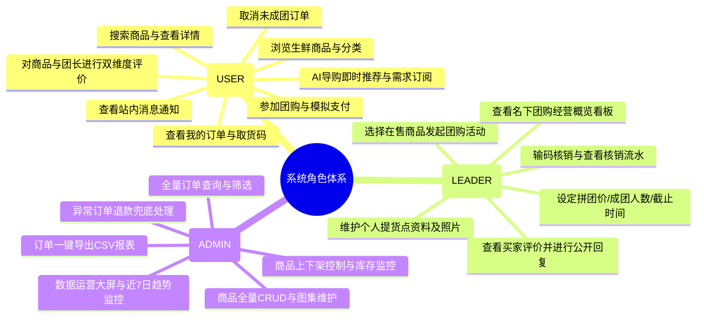
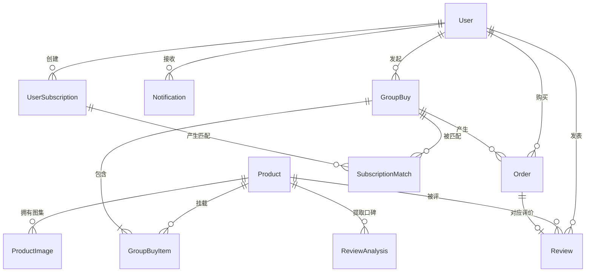
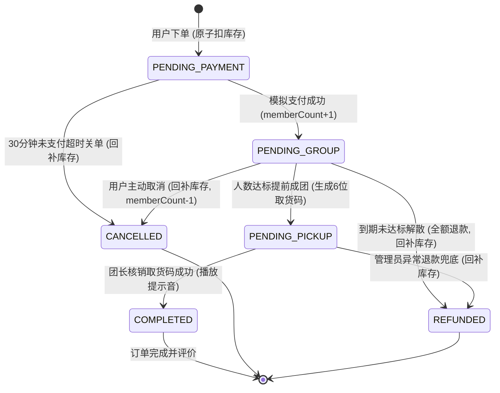
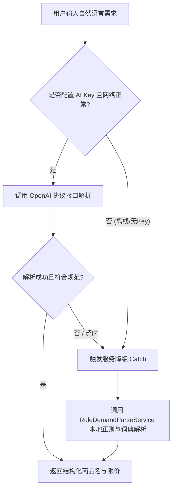

# 基于 Spring Boot 3 与 Vue 3 的社区生鲜团购平台设计与实现

> **核对提示（2026-11-22 已修订对齐）**：本文档已按 [材料核对与实测记录](材料核对与实测记录.md) 将测试统计（后端 19 类 132 项 / 前端 13 项）、并发测试类名与单库存 8 线程实测、成团人数按不同已支付用户去重口径、取货码数据库唯一索引防重与防暴力枚举限流、以及模拟支付/AI 降级边界与当前源码对齐。正式提交前请按学校排版模板核实个人信息与参考文献格式。

**摘要**

随着移动互联技术与社区商业形态的深入融合，社区生鲜团购凭借“以销定采、集单配送、提货点自提”的低履约成本模式，成为解决社区生鲜商品“最后 100 米”配送痛点与降低损耗的重要途径。然而，传统社区电商系统常面临并发高发下的库存超卖、订单状态与团购人数不一致导致的“虚假成团”、自提核销繁琐易冒领，以及商品检索被动、人货匹配效率低下等现实难题。

针对上述挑战，本文设计并实现了一套高可靠、强闭环且融入现代生成式人工智能（LLM）技术的社区生鲜团购平台（FreshCommunity）。系统以后端 Spring Boot 3.2 与 Java 17 为核心骨干，结合 MyBatis-Plus 持久层框架、Spring Security 与 JWT 无状态鉴权体系；前端基于 Vue 3.4 组合式 API、Vite 5 与 Element Plus，采用自定义 Design Tokens 实现了桌面端与移动端（<768px）自适应布局；底层基于 MySQL 8 关系型数据库构建了 11 张第三范式规范化数据表。

本研究的核心成果与技术特色体现在四个方面：第一，**高并发库存原子扣减防超卖机制**，深入利用 MySQL InnoDB 行级排他锁（X 锁）特性，设计单条条件更新语句实现原子扣减，并配合事务内的库存回补策略，在轻量架构下防止了并发超卖；第二，**强一致性双层状态机与自动化治理**，构建涵盖 7 种订单状态的严密流转逻辑，结合团购行锁、按不同已支付用户去重计数以及 CAS 条件更新防止并发重复成团与虚假成团，配合 60 秒定时任务自动完成超时关单与到期解散模拟退款；第三，**融合大语言模型（LLM）的智能导购体系**，设计了流式打字机即时推荐（问 AI）、卡片一键参团下单，以及自然语言需求订阅功能，在需求订阅与评价分析中采用“LLM 优先 + 本地规则词典兜底”的降级架构与“唯一键闸门 + 补偿扫描”可靠匹配机制；第四，**基于 SSE 的单向流式消息推送与安全取货码核销**，实现业务事件秒级推达与基于数据库唯一约束的防冒领、防重复核销闭环。

系统引入了 OpenSpec 规范驱动开发范式，建立了 12 个能力规格基线。经自动化测试验证，后端 19 个测试类共 132 个集成测试用例与前端 13 个单测用例全部通过，在单库存高并发抢购、服务降级容灾与并发补偿等测试场景下表现出良好的健壮性与稳定性，具有较强的工程实践价值。

**关键词**：社区团购；Spring Boot 3；Vue 3；防超卖并发控制；大语言模型；状态机；SSE实时推送；规范驱动开发

---

**Abstract**

With the deep integration of mobile internet technology and community retail business models, community fresh food group buying has emerged as an essential approach to resolving the "last 100 meters" delivery dilemma and mitigating inventory perishability, benefiting from its cost-effective fulfillment paradigm characterized by "sales-driven procurement, consolidated batch logistics, and self-pickup verification". However, conventional community e-commerce platforms frequently encounter persistent challenges, including stock overselling under concurrent traffic, "phantom group success" caused by inconsistencies between order state transitions and participant counts, cumbersome and counterfeit-prone pickup verification, as well as passive product retrieval and inefficient matching between user demands and offerings.

To tackle these problems, this thesis designs and implements a highly dependable, fully closed-loop community fresh food group-buying platform (FreshCommunity) integrated with contemporary Large Language Model (LLM) artificial intelligence. The system employs Spring Boot 3.2 and Java 17 as the backend backbone, integrated with MyBatis-Plus, Spring Security, and stateless JWT authentication. The client side is built upon Vue 3.4 Composition API, Vite 5, and Element Plus, incorporating custom Design Tokens to provide responsive adaptation across both desktop and mobile devices (<768px). The persistence tier utilizes MySQL 8 to establish 11 normalized database tables adhering to Third Normal Form (3NF).

The core technical contributions of this research are summarized in four aspects: First, **an atomic inventory deduction mechanism against overselling**, leveraging MySQL InnoDB row-level exclusive locks (X-locks) through a single conditional update statement to achieve atomic deduction and transaction-level inventory rollback, guaranteeing zero overselling in a lightweight architecture. Second, **a robust dual-layer state machine and automated lifecycle governance**, establishing strict transitions across seven distinct order states, employing CAS optimistic conditional updates to eliminate duplicate success triggers and prevent phantom group formation, accompanied by 60-second scheduled background jobs for automated order timeout closure and dissolution refunds. Third, **an intelligent shopping assistant integrating LLMs**, delivering instant streaming conversational recommendations (Ask AI), one-click card-based group joining, and natural language demand subscription, bolstered by a "LLM-priority with local rule dictionary fallback" resilience mechanism and a "unique-key gatekeeper with compensation scanning" matching strategy. Fourth, **SSE-based unidirectional realtime notification streaming and 6-digit cryptographic pickup code verification**, enabling sub-second business event dispatch and secure, non-repeatable pickup execution.

The system adopts the OpenSpec specification-driven development paradigm, consolidating 12 baseline capabilities. Automated test results show that all 132 backend integration test cases (across 19 test classes) and 13 frontend test cases passed with 100% success. The platform demonstrates strong robustness and reliability under single-inventory concurrency stress, offline failover, and asynchronous compensation, presenting substantial practical engineering and academic value.

**Keywords**: Community Group Buying; Spring Boot 3; Vue 3; Concurrency Control & Anti-Overselling; Large Language Models; Finite State Machine; Server-Sent Events; Specification-Driven Development

---

## 目录

- [第 1 章 绪论](#第-1-章-绪论)
  - [1.1 课题研究背景](#11-课题研究背景)
  - [1.2 国内外研究与产业现状](#12-国内外研究与产业现状)
  - [1.3 课题研究目的与意义](#13-课题研究目的与意义)
  - [1.4 课题主要研究内容](#14-课题主要研究内容)
  - [1.5 论文组织结构](#15-论文组织结构)
- [第 2 章 系统开发技术与理论基础](#第-2-章-系统开发技术与理论基础)
  - [2.1 后端开发技术（Spring Boot 3 与 Java 17）](#21-后端开发技术spring-boot-3-与-java-17)
  - [2.2 前端开发技术（Vue 3 与 Vite 现代工具链）](#22-前端开发技术vue-3-与-vite-现代工具链)
  - [2.3 数据库与并发控制理论（MySQL 8 与 InnoDB 行锁）](#23-数据库与并发控制理论mysql-8-与-innodb-行锁)
  - [2.4 安全鉴权技术（Spring Security 与 JWT）](#24-安全鉴权技术spring-security-与-jwt)
  - [2.5 大语言模型接口与降级技术](#25-大语言模型接口与降级技术)
  - [2.6 规范驱动开发方法论（OpenSpec）](#26-规范驱动开发方法论openspec)
  - [2.7 本章小结](#27-本章小结)
- [第 3 章 系统需求分析](#第-3-章-系统需求分析)
  - [3.1 角色划分与用例分析](#31-角色划分与用例分析)
  - [3.2 核心业务流程分析](#32-核心业务流程分析)
  - [3.3 功能需求规格建模](#33-功能需求规格建模)
  - [3.4 非功能性需求分析](#34-非功能性需求分析)
  - [3.5 本章小结](#35-本章小结)
- [第 4 章 系统总体与详细设计](#第-4-章-系统总体与详细设计)
  - [4.1 系统总体分层架构设计](#41-系统总体分层架构设计)
  - [4.2 数据库概念模型与 E-R 图设计](#42-数据库概念模型与-e-r-图设计)
  - [4.3 数据库逻辑结构与物理表设计](#43-数据库逻辑结构与物理表设计)
  - [4.4 核心业务机制与算法设计](#44-核心业务机制与算法设计)
    - [4.4.1 并发下单库存原子扣减防超卖设计](#441-并发下单库存原子扣减防超卖设计)
    - [4.4.2 订单与团购状态机及防虚假成团设计](#442-订单与团购状态机及防虚假成团设计)
    - [4.4.3 取货码加密生成与核销安全设计](#443-取货码加密生成与核销安全设计)
    - [4.4.4 AI 导购“LLM优先+规则兜底”高可用设计](#444-ai-导购llm优先规则兜底高可用设计)
    - [4.4.5 基于 SSE 的服务端单向实时推送机制](#445-基于-sse-的服务端单向实时推送机制)
  - [4.5 接口设计规范与交互式文档](#45-接口设计规范与交互式文档)
  - [4.6 本章小结](#46-本章小结)
- [第 5 章 系统核心功能实现](#第-5-章-系统核心功能实现)
  - [5.1 用户中心与鉴权安全实现](#51-用户中心与鉴权安全实现)
  - [5.2 商品检索与分类呈现实现](#52-商品检索与分类呈现实现)
  - [5.3 团购广场与拼团下单主链路实现](#53-团购广场与拼团下单主链路实现)
  - [5.4 原子防超卖与库存回补核心代码实现](#54-原子防超卖与库存回补核心代码实现)
  - [5.5 定时任务调度（解散退款与超时关单）实现](#55-定时任务调度解散退款与超时关单实现)
  - [5.6 团长核销台专注模式实现](#56-团长核销台专注模式实现)
  - [5.7 AI 即时推荐（流式打字机）与需求订阅实现](#57-ai-即时推荐流式打字机与需求订阅实现)
  - [5.8 消息实时推送与前端反馈实现](#58-消息实时推送与前端反馈实现)
  - [5.9 管理端数据大屏与订单导出实现](#59-管理端数据大屏与订单导出实现)
  - [5.10 移动端响应式适配实现](#510-移动端响应式适配实现)
  - [5.11 本章小结](#511-本章小结)
- [第 6 章 系统测试与分析](#第-6-章-系统测试与分析)
  - [6.1 测试环境与测试策略](#61-测试环境与测试策略)
  - [6.2 自动化测试用例矩阵](#62-自动化测试用例矩阵)
  - [6.3 核心功能模块集成测试](#63-核心功能模块集成测试)
  - [6.4 高并发库存扣减压力实测（零超卖验证）](#64-高并发库存扣减压力实测零超卖验证)
  - [6.5 大模型接口降级与断网容灾实测](#65-大模型接口降级与断网容灾实测)
  - [6.6 测试总结与软件质量评价](#66-测试总结与软件质量评价)
  - [6.7 本章小结](#67-本章小结)
- [第 7 章 总结与展望](#第-7-章-总结与展望)
  - [7.1 本文工作总结](#71-本文工作总结)
  - [7.2 系统的不足之处](#72-系统的不足之处)
  - [7.3 未来的演进方向](#73-未来的演进方向)
- [参考文献](#参考文献)
- [致谢](#致谢)

---

## 第 1 章 绪论

### 1.1 课题研究背景
在数字化零售与城市社区生活形态日趋紧密的背景下，生鲜食品因其高频次、刚需性、强时效性及高损耗率等特征，一直是电子商务领域最具挑战的品类之一。传统生鲜电商多采用“中心仓 + 冷链干线 + 骑手即时配送（前置仓）”模式，单笔订单的履约成本居高不下，且末端配送在生鲜损耗与配送时延上极易产生损耗纠纷。

为解决生鲜“最后 100 米”的高成本履约难题，社区生鲜团购模式应运而生。该模式以居民住宅小区为物理单元，以社区提货点经营者（通常为便利店主或居民团长）为信任纽带，通过“团长开团发起拼团 → 社区居民在线参团 → 人数达标集体成团 → 供应商集单配送至提货点 → 居民凭码自提核销”的闭环，将分散的零散订单汇聚为批量订单，实现了“以销定采、以销定送”，省去了高昂的末端骑手配送费，大幅压缩了生鲜流通成本与仓储损耗。

然而，社区生鲜团购在实际软件落地过程中，对系统的并发安全性、状态一致性与用户交互效率提出了严苛的技术要求。因此，研发一套具备高并发防护、状态自动流转治理、提货安全可控且融入智能交互手段的社区生鲜团购系统，具有重要的理论研究与应用实践价值。

### 1.2 国内外研究与产业现状
国外在社区电商方面主要以订购式农场直配（如 Community Supported Agriculture, CSA）及次日达自提柜（如 Amazon Hub Locker）为主，其技术架构偏向于计划性供应链排期，较少面临突发性高并发秒杀与拼团成败强挂钩的业务场景。

而在国内，社区团购经历了从早期粗放式补贴竞争到规范化高质量运营的演进。在技术层面，早期部分中小型团购系统由于开发周期短促，普遍存在以下技术短板：
1. **库存超卖与并发安全隐患**：许多系统采用“先查库存、代码比对、再扣减”的非原子操作，在高并发抢购热门平价生鲜时极易发生超卖，引发用户纠纷与客诉；
2. **状态机与人数一致性漏洞**：部分系统在订单取消、超时关单时未能与团购活动的总参团人数保持原子联动，容易出现“虚假成团”（即有效订单人数未达标却误判为成团发货）；
3. **自提核销体验繁琐与冒领风险**：缺乏严密的安全凭据与防重校验，核销流程依赖人工纸质核对，效率低下；
4. **导购交互被动单向**：传统系统仅提供静态商品列表与分类筛选，用户无法基于预算与口语化意图获得个性化推荐，也不能在缺货或未开团时进行有效的主动需求表达。

### 1.3 课题研究目的与意义
针对现有社区生鲜团购系统的技术痛点，本课题旨在基于先进的企业级开发技术栈（Spring Boot 3 与 Vue 3），设计并实现一套具备**强闭环、高并发防护、状态强一致性与智能化导购能力**的社区生鲜团购平台（FreshCommunity）。

本课题的实践意义主要体现在：
- **工程实践价值**：构建起涵盖“用户浏览与参团、团长开团与核销、管理员商品与订单监控”的三角色完整商业闭环，采用无依赖的数据库行锁实现极简高效的防超卖控制，为中小型社区电商系统提供了高性价比的架构范式。
- **技术创新价值**：将大型语言模型（LLM）与 Server-Sent Events（SSE）流式通信引入传统电商业务，开创性地设计了自然语言即时推荐与需求订阅机制，并建立了“LLM 优先 + 规则词典兜底”的高可用架构，探索了 AI 技术在垂直电商领域落地的可靠性路径。
- **软件质量价值**：全流程引入规范驱动开发（OpenSpec），确保每一项功能均有可追溯的规范场景与自动化测试，极大地提升了软件工程的交付质量。

### 1.4 课题主要研究内容
本论文围绕 FreshCommunity 平台的设计与实现，重点开展了以下几方面的研究与开发工作：
1. **社区团购核心交易闭环建模**：设计商品、团购、订单、评价等领域模型，规范订单与团购的生命周期状态机。
2. **高并发库存原子扣减与一致性机制研究**：基于 MySQL InnoDB 引擎行级锁机制，实现单条 SQL 条件原子扣库存，结合本地事务与定时任务调度，解决并发超卖、虚假成团与超时未支付关单回补难题。
3. **安全自提核销与实时推送体系设计**：研究基于加密级随机数的 6 位取货码生成算法与归属校验防重核销方案；引入 SSE 单向流式长连接，实现业务事件秒级主动推达前端。
4. **生成式 AI 智能导购与容灾降级架构**：探索基于 OpenAI 协议标准的大模型即时推荐；设计自然语言需求订阅的“LLM 优先 + 规则降级”双层解析链路与补偿扫描防漏配机制；实现基于文本分析的评价洞察。
5. **规范驱动开发与全方位测试验证**：遵循 OpenSpec 规范，编写 132 个后端自动化测试（19 个测试类）与 13 个前端测试，针对极端并发抢购与服务断网进行容灾实测。

### 1.5 论文组织结构
本论文共分为 7 章，各章节内容安排如下：
- **第 1 章 绪论**：阐述课题背景、国内外研究现状、研究目的意义及主要研究内容。
- **第 2 章 系统开发技术与理论基础**：介绍 Spring Boot 3、Vue 3、MySQL 8、Spring Security、LLM 接口及 OpenSpec 开发方法等关键技术。
- **第 3 章 系统需求分析**：对系统三类角色进行用例建模，梳理业务主链路流程，定义功能与非功能性需求。
- **第 4 章 系统总体与详细设计**：阐述系统架构、数据库概念与物理表设计，深入剖析防超卖、状态机、核销与 AI 降级等核心机制。
- **第 5 章 系统核心功能实现**：详细展示用户端、团长端、管理端及 AI 导购模块的关键实现代码与交互界面。
- **第 6 章 系统测试与分析**：阐述测试环境与测试矩阵，重点展示高并发防超卖压测、服务降级实测与自动化测试结果。
- **第 7 章 总结与展望**：全面总结课题研究成果，指出系统当前存在的局限，并对未来演进方向进行展望。

---

## 第 2 章 系统开发技术与理论基础

### 2.1 后端开发技术（Spring Boot 3 与 Java 17）
本系统后端选用 **Spring Boot 3.2.5** 结合 **Java 17（LTS）** 进行构建。
Spring Boot 3 带来了全面的底层升级，原生支持 Spring Framework 6 与 Jakarta EE 9/10 规范。Java 17 提供了强化的人性化语法（如 `record` 声明、密封类 `sealed class`、文本块 `Text Blocks` 等），并在垃圾回收（ZGC、G1）与 JVM 吞吐量上具备优异表现。

在持久层，系统集成了 **MyBatis-Plus 3.5.5**。MyBatis-Plus 在继承 MyBatis 灵活可控的 SQL 定制能力的同时，提供了通用 CRUD 接口、Lambda 链式条件构造器、内置分页插件以及逻辑删除（`@TableLogic`）与自动审计字段填充机制，大幅降低了重复代码量。

### 2.2 前端开发技术（Vue 3 与 Vite 现代工具链）
前端采用基于 **Vue 3.4** 的组合式 API（Composition API，`<script setup>`）构建。相比传统的 Options API，Composition API 允许将同一业务逻辑关注点（如倒计时计算、状态映射、数据加载）封装在独立的 Composable 函数中，极大增强了前端代码的高内聚与可复用性。

构建工具选用 **Vite 5**，利用现代浏览器对 ES Module 的原生支持，实现了基于 Rollup 的秒级冷启动与极速热模块替换（HMR）。UI 组件库选用 **Element Plus**，结合项目定制的 `tokens.css` 设计系统，统一定义了品牌绿色调（`#1E9E5A`）、圆角、阴影与排版规范，并针对小屏幕设备（<768px）通过媒体查询打造了移动端自适应交互。

### 2.3 数据库与并发控制理论（MySQL 8 与 InnoDB 行锁）
系统持久化存储选用 **MySQL 8.0+**。MySQL 默认的 **InnoDB** 存储引擎支持完全的 ACID 事务特性，并提供了行级排他锁（X Lock）、共享锁（S Lock）及多版本并发控制（MVCC）。

在电商并发库存扣减中，常见的方案包括：
1. **悲观加锁（SELECT ... FOR UPDATE）**：在查询阶段显式锁定记录，但并发度较低且容易造成数据库连接堆积；
2. **分布式锁（Redis + Lua）**：性能高，但需要额外运维 Redis 集群，且引入缓存与数据库双写一致性与网络抖动等额外复杂度；
3. **数据库行级条件更新原子操作（`UPDATE ... WHERE stock >= qty`）**：本系统所采用的方案。该方案利用 InnoDB 引擎在执行 UPDATE 语句时对对应主键记录自动施加的排他写锁，将多线程并发争抢单行记录的操作转化为数据库内核底层的串行化执行队列。由于扣减条件在 WHERE 子句中一体化判断，受影响行数返回 0 即代表当前瞬间库存不足，彻底避免了超卖现象，在单机中小型电商系统中具有最高的可靠性与最低的运维开销。

### 2.4 安全鉴权技术（Spring Security 与 JWT）
系统安全鉴权基于 **Spring Security 6** 与 **JSON Web Token（jjwt 0.12.5）** 实现无状态安全认证。
用户登录成功后，后端使用强哈希算法（BCrypt）比对凭据，并由 `JwtUtil` 工具类签发带有用户 ID、用户名与角色列表的 JWT Token，有效期设置为 24 小时。客户端在后续 HTTP 请求中通过请求头 `Authorization: Bearer <token>` 携带凭据。

自定义过滤器 `JwtAuthenticationFilter` 在 Spring Security 过滤器链前置拦截请求，解析 Token 并构造 `UsernamePasswordAuthenticationToken` 注入上下文；结合 `@EnableMethodSecurity` 注解，各个 Controller 方法可通过 `@PreAuthorize("hasRole('ADMIN')")` 实现严格细粒度的角色鉴权隔离；对于认证失败与越权访问，系统定制了 `AuthenticationEntryPoint` 与 `AccessDeniedHandler`，确保统一返回 `{code: 401/403, msg: "...", data: null}` 的规范 JSON 报文。

### 2.5 大语言模型接口与降级技术
为了赋予传统社区团购系统智能化的交互体验，系统接入了遵循 **OpenAI 兼容协议**的大语言模型（如 DeepSeek-V3 / Qwen 等）。
系统设计了 `AiClient` 客户端，利用 Spring Framework 6 的 `RestClient` 封装了标准的 `/chat/completions` 调用。为了避免大模型深度思考机制带来的长达数十秒的延迟，客户端在请求参数中通过 `chat_template_kwargs.thinking=false` 标准参数显式关闭思考模式，确保秒级生成推荐文本。

针对外部大模型 API 可能发生的断网、响应超时（默认 5 秒超时保护）或欠费等高风险异常，系统创新性地采用了**双层分级降级架构**：在需求解析与评价分析中，大模型调用失败时由本地正则表达式与规则词典服务接管，保证核心业务绝对不因外部不可控依赖而瘫痪。

### 2.6 规范驱动开发方法论（OpenSpec）
本项目全流程实践了**规范驱动开发（Specification-Driven Development, SDD）**，引入了国际先进的 **OpenSpec** 规范框架。
在传统开发流程中，软件工程常面临“需求口头传递、代码频繁修改、文档严重滞后”的顽疾。而在 OpenSpec 模式下，任何一个功能特性的引入都必须经历严格的生命周期：
1. **Proposal（提案）**：明确本次变更要解决的业务痛点、系统边界（明确做什么、明确不做什么）；
2. **Design（技术架构决策）**：记录技术选型理由、架构折衷（Trade-offs）与数据库变动；
3. **Specs（规范增量）**：采用规范的 Gherkin 风格（`GIVEN-WHEN-THEN`）编写验收场景；
4. **Tasks（任务清单）**：将开发任务拆解为原子步进项；
5. **Archive（归档）**：实施并通过全量自动化测试后，增量合并进入主基线。

---

## 第 3 章 系统需求分析

### 3.1 角色划分与用例分析
FreshCommunity 平台面向社区团购场景，定义了三类核心角色：



### 3.2 核心业务流程分析

#### 3.2.1 拼团购物与核销主流程
拼团购物是社区团购的核心生命线，其主链路流程如下：
1. 团长选择系统在售商品，设置成团人数（如 3 人）与截止时间发起团购活动；
2. 用户在团购广场浏览并选定数量下单，系统原子扣减商品库存，生成待支付订单；
3. 用户在模拟收银台完成支付，订单状态推进至“待成团”，团购已支付人数自增 1；
4. 当已支付人数达到目标人数瞬间，触发成团判定，系统自动为每笔订单生成加密 6 位数字取货码，并经由 SSE 向买家推送成团通知；
5. 供应商将生鲜集单配送到自提点，用户凭 6 位取货码到店自提；
6. 团长在核销台输入取货码，系统校验归属无误后将订单置为“已完成”，并播放提示音；
7. 用户在订单中心对生鲜品质与团长自提服务分别打出 1~5 星评分与文字评价。

#### 3.2.2 超时关单与解散退款流程
为保障商户库存周转与消费者权益，系统设计了自动化后台治理流程：
- **未支付超时关单**：用户下单后占用库存，若 30 分钟内未完成模拟支付，后台定时任务将其标记为“已取消”，并原子回补扣减的商品库存；
- **到期未达标解散退款**：若团购到达截止时间，已支付人数仍未达到成团人数阈值，后台定时任务将团购活动标记为“解散（FAIL）”，将该活动下全部已支付订单原子更新为“已退款（REFUNDED）”，全额模拟退款、回补库存，并向用户推送解散退款站内信。

#### 3.2.3 AI 导购即时推荐与需求订阅流程
- **即时推荐流程**：用户在 AI 导购界面输入日常语言需求，系统在服务端检索在售商品与当前进行中的团购数据，注入 LLM 上下文，大模型通过 SSE 流式打字机输出“推荐 + 理由 + 小贴士”，并在前端渲染可点击商品卡片，用户点击卡片即可直接确认数量参团下单；
- **需求订阅流程**：用户输入价格偏好（如“10元以内的苹果”），系统解析为标准结构化条件（关键词 + 价格上限），用户确认后创建订阅。系统在创建瞬间即时检索当前团，且在后续任意团长开新团时自动匹配，命中后发送站内通知。

### 3.3 功能需求规格建模
系统共定义了 11 个一级功能能力模块：

| 模块标识 | 模块名称 | 核心功能点 |
| :--- | :--- | :--- |
| **FR-1** | 用户与权限 | 自助注册、BCrypt 加密存储、JWT 鉴权、修改密码、头像上传、团长提货点信息及实拍图维护。 |
| **FR-2** | 商品管理 | 管理员商品增删改查、多图集维护、自由分类、上下架控制、低库存标红预警。 |
| **FR-3** | 团购活动 | 团长开团、自定义拼团价校验、团购广场检索与分类过滤、倒计时与进度展示。 |
| **FR-4** | 库存管理 | 下单单条 SQL 条件原子扣减、受影响行数防超卖拦截、取消与退款原子回补。 |
| **FR-5** | 订单管理 | 7 状态严密状态机、订单详情票据、待成团取消、管理员退款兜底、订单 CSV 导出。 |
| **FR-6** | 提货核销 | 6 位安全数字取货码、仅限本团归属校验、防重复核销、核销台专注模式与音频反馈。 |
| **FR-7** | 数据看板 | 5 大运营 KPI 统计卡片、原生 SVG 近 7 日趋势折线图、订单状态分布条。 |
| **FR-8** | 评价体系 | 核销后一单一评、商品与团长双维度评分、团长一层公开回复、评价标签洞察展示。 |
| **FR-9** | 站内消息 | 6 类业务事件通知、SSE 实时推送流、未读消息角标联动、通知直达跳转。 |
| **FR-10** | 界面交互 | Design Tokens 视觉系统、骨架屏、空状态组件、响应式移动端导航与触摸靶心。 |
| **FR-11** | AI 智能导购 | 大模型流式问答、卡片一键直购、需求订阅、LLM 与规则双层降级、周期补偿扫描。 |

### 3.4 非功能性需求分析
1. **并发正确性**：在多线程高并发下单抢购时，库存绝对不能出现负数（零超卖）；在成团判定时，无论多高并发，成团逻辑与发码只能被触发一次。
2. **响应性能**：常用查询接口（商品列表、团购广场、订单列表）响应时间应控制在 100ms 以内；AI 推荐由于采用流式打字机输出，首字延迟应在 1.5s 以内。
3. **高可用性与容灾性**：在外部大模型服务不可达或未配置 API Key 时，系统的基础电商功能（下单、支付、核销）以及需求订阅功能必须 100% 正常运行，具备静默降级能力。
4. **易用性与响应式体验**：前端对移动端（手机浏览器，屏幕宽度 <768px）提供针对性适配，包含底部 Tab Bar 导航、大触控按钮与防溢出弹窗。

---

## 第 4 章 系统总体与详细设计

### 4.1 系统总体分层架构设计
系统采用经典的客户端-服务端（C/S）分层架构，总体架构图如下所示：

```mermaid
flowchart TD
    subgraph ClientLayer [表现层 (Vue 3 + Element Plus)]
        PC[PC 桌面端布局]
        Mobile[移动端响应式布局]
        Store[Pinia 状态中心: User / Notification]
        SSE_Client[EventSource 实时监听器]
    end

    subgraph GatewayLayer [接入与安全层]
        Nginx[Nginx 反向代理 & 静态资源托管]
        Security[Spring Security 过滤链]
        JWT_Filter[JwtAuthenticationFilter 鉴权校验]
    end

    subgraph ServiceLayer [业务逻辑层 (Spring Boot 3)]
        OrderSvc[OrderService 订单与原子库存]
        GroupSvc[GroupBuyService 团购生命周期]
        SubSvc[SubscriptionService 订阅与匹配]
        AiSvc[AiRecommendService & AiClient]
        PushSvc[NotificationPushService (SSE SseEmitter)]
        JobSvc[ScheduledJobs 60秒定时任务集群]
    end

    subgraph DataLayer [持久化与外部服务]
        MySQL[(MySQL 8 数据库)]
        LLM[外部 OpenAI 协议大模型服务]
        Uploads[本地存储 uploads/]
    end

    ClientLayer --> GatewayLayer
    GatewayLayer --> ServiceLayer
    ServiceLayer --> DataLayer
```

### 4.2 数据库概念模型与 E-R 图设计
系统涉及的核心实体包括：用户（User）、商品（Product）、商品图集（ProductImage）、团购活动（GroupBuy）、团购明细快照（GroupBuyItem）、订单（Order）、评价（Review）、站内消息（Notification）、用户订阅（UserSubscription）、订阅匹配记录（SubscriptionMatch）及评价洞察（ReviewAnalysis）。



### 4.3 数据库逻辑结构与物理表设计
系统设计了 11 张数据表，所有表均采用 InnoDB 存储引擎与 `utf8mb4_unicode_ci` 编码：

#### 1. 用户表（`user`）
存储系统所有角色的核心账户与提货点档案信息。
- `id` (BIGINT, PK, AUTO_INCREMENT)
- `username` (VARCHAR(64), UNIQUE, NOT NULL): 用户名
- `password` (VARCHAR(128), NOT NULL): BCrypt 加密密文
- `role` (VARCHAR(20), NOT NULL): 角色枚举（USER / LEADER / ADMIN）
- `pickup_point_name` (VARCHAR(128)): 团长自提点名称
- `pickup_point_address` (VARCHAR(255)): 团长自提点详细地址
- `avatar_url` (VARCHAR(255)): 用户头像地址
- `pickup_point_image_url` (VARCHAR(255)): 提货点实拍照片
- `created_at`, `updated_at`, `deleted` (TINYINT): 审计与逻辑删除字段

#### 2. 商品表（`product`）与图集表（`product_image`）
- `product`: `id`, `name`, `category` (分类，默认'其他'), `price` (DECIMAL(10,2)), `stock` (INT, 剩余物理库存), `image_url` (封面首图), `description`, `status` (TINYINT, 1上架 0下架);
- `product_image`: `id`, `product_id` (BIGINT, 关联商品), `image_url`, `sort` (INT, 排序序号)。

#### 3. 团购活动表（`group_buy`）与明细快照表（`group_buy_item`）
- `group_buy`: `id`, `leader_id` (BIGINT), `title` (VARCHAR(128)), `target_count` (成团人数), `deadline` (DATETIME), `status` (VARCHAR(20), ONGOING/SUCCESS/FAIL), `member_count` (INT, 当前已支付的不同用户数);
- `group_buy_item`: `id`, `group_buy_id`, `product_id`, `price_snapshot` (DECIMAL(10,2), 开团拼团价快照)。

#### 4. 订单表（`` `order` ``）
因 `order` 为 SQL 关键字，在 DDL 与实体中均强制使用反引号转义。
- `id` (BIGINT, PK), `order_no` (VARCHAR(64), UNIQUE), `user_id`, `group_buy_id`, `product_id`, `quantity`, `amount` (总金额), `status` (PENDING_PAYMENT / PENDING_GROUP / SUCCESS / PENDING_PICKUP / COMPLETED / CANCELLED / REFUNDED), `pickup_code` (VARCHAR(32), 6位核销码，带 `uk_order_pickup_code` 唯一索引), `pay_time`。

#### 5. 评价表（`review`）与评价洞察表（`review_analysis`）
- `review`: `id`, `order_id` (BIGINT, UNIQUE KEY 防重复评价), `user_id`, `product_id`, `leader_id`, `product_score` (1-5), `leader_score` (1-5), `content` (VARCHAR(500)), `leader_reply` (VARCHAR(500), 团长回复), `leader_replied_at`;
- `review_analysis`: `id`, `review_id` (UNIQUE), `product_id`, `sentiment` (POSITIVE/NEGATIVE/NEUTRAL), `tags` (逗号分隔关键词)。

#### 6. 消息与订阅表（`notification`、`user_subscription`、`subscription_match`）
- `notification`: `id`, `user_id`, `type`, `title`, `content`, `ref_order_id`, `ref_group_buy_id`, `is_read` (0/1);
- `user_subscription`: `id`, `user_id`, `keyword` (归一化商品名), `max_price`, `source_text`;
- `subscription_match`: `id`, `subscription_id`, `group_buy_id`, `UNIQUE KEY uk_sub_group (subscription_id, group_buy_id)`（数据库级幂等防重闸门）。

### 4.4 核心业务机制与算法设计

#### 4.4.1 并发下单库存原子扣减防超卖设计
在生鲜拼团的并发下单场景下，若采用先 SELECT 判断再 UPDATE，极易在两步之间被其他线程抢占导致库存穿透。
本系统在 `ProductMapper` 中定义了纯原子的扣减 SQL：
```sql
UPDATE product
SET stock = stock - #{quantity}
WHERE id = #{productId}
  AND stock >= #{quantity}
  AND deleted = 0
```
**设计机理**：
1. MySQL 执行更新时自动对主键行记录加排他 X 锁；
2. 并发多个事务执行该语句时自动在数据库引擎层排队；
3. `AND stock >= #{quantity}` 充当内联条件，当库存不足时，SQL 执行成功但影响行数（affected rows）为 0；
4. Java 业务代码根据 `affectedRows > 0` 判定扣减结果，若为 0 则直接抛出 `BusinessException("商品库存不足")`，并在事务内拦截该订单创建。

#### 4.4.2 订单与团购状态机及防虚假成团设计
订单状态流转图如下所示：



**防虚假成团与不同用户去重计数设计**：
系统将团购的 `member_count` 定义为**已支付的不同用户数**：同一用户在同一团购下支付多笔订单只计为 1 人（支付前通过 `findPendingGroupOrderForUser` 锁定查询是否已有 `PENDING_GROUP` 订单）。当用户取消或管理员退款处于 `PENDING_GROUP` 的订单时，系统在团购行锁保护下调用 `decrementMemberIfLastPendingOrder`，仅当该用户在该团下已无其他 `PENDING_GROUP` 订单时才执行：
`UPDATE group_buy SET member_count = member_count - 1 WHERE id = #{id} AND member_count > 0`，并同步调用 `PayService.refund` 执行模拟退款（若模拟退款失败则整个数据库事务回滚）。
若省略该机制，同一用户拆单刷单或取消已付订单都会导致人数虚高，引发有效参团人数不足却提前成团的“虚假成团”问题。

**并发成团 CAS 条件判定**：
下单与支付均先通过 `groupBuyMapper.lockOpenGroup(groupBuyId)` 获取仍在进行中且未过截止时间的团购行锁。当支付成功使 `member_count >= target_count` 时，通过条件更新语句推进团购状态：
`UPDATE group_buy SET status = 'SUCCESS' WHERE id = #{id} AND status = 'ONGOING' AND member_count >= target_count`。
若受影响行数等于 1，则遍历所有 `PENDING_GROUP` 已支付订单，将其状态推进为 `SUCCESS`（已成团待取货）、逐单分配唯一的 6 位取货码并派发成团通知；已成团后其余仍处于 `PENDING_PAYMENT` 的未支付订单将无法再继续支付，但仍可取消并回补库存。

#### 4.4.3 取货码加密生成与核销安全设计
取货码生成算法采用 Java `SecureRandom` 生成 6 位数字，并依靠数据库 `order` 表的 `uk_order_pickup_code` 唯一索引防止并发碰撞（碰撞时捕获 `DuplicateKeyException` 自动重试）：
```java
private String assignUniquePickupCode(Long orderId) {
    for (int attempt = 0; attempt < 20; attempt++) {
        String code = String.format("%06d", SECURE_RANDOM.nextInt(1_000_000));
        try {
            return orderMapper.assignPickupCode(orderId, code) == 1 ? code : null;
        } catch (DuplicateKeyException collision) {
            // 唯一索引捕获并发冲突，重新生成
        }
    }
    throw new IllegalStateException("取货码生成失败，请重试");
}
```
团长核销时执行四级安全校验：
1. **防暴力枚举滑动窗口限流**：同一团长在 5 分钟窗口内连续核销失败达 5 次，自动触发 5 分钟临时锁定（拒绝请求并提示 `"核销失败次数过多，请稍后再试"`），核销成功后立即清零计数；
2. **订单与状态校验**：校验取货码对应的订单是否存在且处于 `SUCCESS`（或历史兼容状态 `PENDING_PICKUP`）待取货状态；
3. **团长归属校验**：校验团购发起人 `groupBuy.getLeaderId().equals(leaderId)`，杜绝跨自提点冒领；
4. **原子单向流转**：通过条件更新 `UPDATE \`order\` SET status = 'COMPLETED' WHERE id = #{id} AND status = #{expectedStatus}` 原子推进为 `COMPLETED`，受影响行数为 0 则拒绝，防止并发重复核销。

#### 4.4.4 AI 导购“LLM优先+规则兜底”高可用设计
在需求订阅与推荐解析中，大模型调用可能存在超时与异常。系统定义了 `DemandParseService` 接口，并由 `LlmParseService`（优先级最高的 `@Primary` Bean）与 `RuleDemandParseService`（规则实现）共同组成双层解析体系：



在匹配通知上，系统利用 `subscription_match` 表建立数据库唯一联合索引 `(subscription_id, group_buy_id)`，通过 `INSERT IGNORE` 抢占排他锁。即使发生网络重发或并发开团，也仅能插入成功一次，确保同一订阅对同一团购至多发送一次站内通知；并配合 60 秒定时补偿扫描，彻底关上并发错失的漏推窗口。

#### 4.4.5 基于 SSE 的服务端单向实时推送机制
系统选用 **Server-Sent Events（SSE）** 替代重型的 WebSocket 实现通知流推送。
客户端通过 `GET /api/notifications/stream` 建立持久 HTTP 连接，服务端返回 `SseEmitter` 实例并将其缓存在 `NotificationPushService` 的并发哈希表中（`Map<Long, SseEmitter>`）。当订单成团、核销或被管理员退款时，事务提交监听器自动提取该用户对应的 Emitter 发送事件，前端监听到事件后自动播放轻柔提示音并无感自增顶栏未读角标。

### 4.5 接口设计规范与交互式文档
系统严格遵循 RESTful API 设计规范，全系统响应统一包装为泛型 `Result<T>` 实体：
```json
{
  "code": 200,
  "msg": "success",
  "data": { ... }
}
```
系统引入了 **Springdoc OpenAPI 3.0**，开发人员与评审人员只需在浏览器中访问 `http://localhost:8080/swagger-ui.html`，即可查看系统全部 48 个接口的入参结构、出参样例，并通过“Authorize”按钮输入 JWT 令牌进行实时在线调试。

---

## 第 5 章 系统核心功能实现

### 5.1 用户中心与鉴权安全实现
用户与权限模块负责三类角色的认证与个人资料维护。
在 `AuthController` 中，`register` 接口对用户名唯一性进行前置检验，使用 BCrypt 算法完成加盐哈希：
```java
user.setPassword(passwordEncoder.encode(request.getPassword()));
```
个人中心页面（`Profile.vue`）允许所有角色更换头像，支持团长维护自提点名称、地址及门头照片。为了保障图片安全，头像与提货点照片均强制校验是否带有本站允许的路径前缀（`/uploads/` 或 `/images/`），有效抵御了外部跨站图片伪造攻击。

### 5.2 商品检索与分类呈现实现
商品浏览页面（`ProductList.vue`）与管理端商品列表（`AdminProducts.vue`）支持丰富的多维检索。
后端 `ProductController.list` 接入 MyBatis-Plus 分页插件 `Page<Product>`，支持按商品名称模糊检索、分类筛选与排序（支持按最新创建、价格升序、价格降序），并且在 Controller 层对 `sort` 字段进行了严格的白名单校验，防止 SQL 注入。
商品详情页（`ProductDetail.vue`）支持多图轮播大图预览，并在页面底部自动聚合展示该商品的历史口碑标签与同类其他推荐商品（“看了又看”）。

### 5.3 团购广场与拼团下单主链路实现
团购广场（`UserGroups.vue`）直观呈现了所有正在进行中的团购活动。
页面顶部新增了**关键词搜索框**与**品类筛选标签**，支持用户按商品名称、分类及“⏰即将截止”、“🔥马上成团”进行无级混合筛选。
用户点击“立即参团”调起下单弹窗，确认购买数量（1~99件）与对应自提点地址后创建订单。随后拉起模拟收银台弹窗，用户点击“确认模拟支付”后调用 `POST /api/orders/{id}/pay`，订单即时流转为 `PENDING_GROUP` 状态。

### 5.4 原子防超卖与库存回补核心代码实现
库存扣减与回补逻辑集中在 `OrderService` 与 `ProductMapper` 中：
```java
@Transactional(rollbackFor = Exception.class)
public OrderVO createOrder(Long userId, Long groupBuyId, Integer quantity) {
    GroupBuy groupBuy = groupBuyMapper.selectById(groupBuyId);
    if (groupBuy == null || !"ONGOING".equals(groupBuy.getStatus())) {
        throw new BusinessException("团购活动不存在或已结束");
    }
    if (groupBuy.getDeadline().isBefore(LocalDateTime.now())) {
        throw new BusinessException("团购活动已过截止时间");
    }
    GroupBuyItem item = groupBuyItemMapper.selectOne(
        new LambdaQueryWrapper<GroupBuyItem>().eq(GroupBuyItem::getGroupBuyId, groupBuyId)
    );
    // 原子扣减物理库存
    int updated = productMapper.deductStock(item.getProductId(), quantity);
    if (updated == 0) {
        throw new BusinessException("商品库存不足，手慢了");
    }
    // 创建待支付订单
    Order order = new Order();
    order.setOrderNo("ORD" + System.currentTimeMillis() + UUID.randomUUID().toString().substring(0, 4));
    order.setUserId(userId);
    order.setGroupBuyId(groupBuyId);
    order.setProductId(item.getProductId());
    order.setQuantity(quantity);
    order.setAmount(item.getPriceSnapshot().multiply(BigDecimal.valueOf(quantity)));
    order.setStatus("PENDING_PAYMENT");
    orderMapper.insert(order);
    return convertToVO(order);
}
```

### 5.5 定时任务调度（解散退款与超时关单）实现
在 `ScheduledJobs` 中，通过 `@Scheduled(fixedRate = 60000)` 每 60 秒触发一次自动化治理任务：
```java
@Scheduled(fixedRate = 60000)
public void processExpiredGroupBuys() {
    // 捞取到达截止时间但仍处于 ONGOING 状态的团购
    List<GroupBuy> expiredGroups = groupBuyMapper.selectList(
        new LambdaQueryWrapper<GroupBuy>()
            .eq(GroupBuy::getStatus, "ONGOING")
            .le(GroupBuy::getDeadline, LocalDateTime.now())
    );
    for (GroupBuy g : expiredGroups) {
        groupBuyService.handleExpiredGroup(g);
    }
}
```
在 `handleExpiredGroup` 内部，若已支付人数未达标，则执行 CAS 更新团购为 `FAIL`，将该团名下所有已支付订单批量置为 `REFUNDED`，原子回补被占用的商品库存，并批量向用户写入解散退款站内通知。

### 5.6 团长核销台专注模式实现
团长核销页面（`LeaderVerify.vue`）专为自提核销场景定制了“专注模式”：
- 采用 32px 大号等宽字体输入框与数字软键盘适配；
- 输入 6 位提货码后点击“确认核销”，调用 `POST /api/orders/verify?pickupCode=XXXXXX`；
- 核销成功后，顶部常驻醒目绿色成功横条，触发浏览器音频播放核销成功提示音；
- 页面下方即时展示该团长名下的“最近 10 笔核销记录”，清晰显示提货商品名与自提时间，方便现场查账比对。

### 5.7 AI 即时推荐（流式打字机）与需求订阅实现
在 `AiShoppingAssistant.vue` 中，用户可以在“问 AI”标签页输入一句话，系统调用 `POST /api/ai/recommend/stream`。后端基于 SSE 协议，将大模型输出拆解为流式文本事件逐块推送到前端，前端实现打字机动态渲染；模型回答中点名的商品被前端捕获并转换为交互卡片，支持用户直接在卡片上参团下单。

在需求订阅页，用户输入如“15元以内的橙子”，调用 `POST /api/subscriptions/parse` 预览解析出来的结构化标签（关键词：橙子，最高限价：15.00），点击“确认订阅”后落库，并即时触发针对进行中团购的匹配检测。

### 5.8 消息实时推送与前端反馈实现
前端在根布局 `App.vue` 挂载时通过 `src/utils/sse.js` 连接后端的 `/api/notifications/stream`。
收到 `notification` 事件后，Pinia 中的 `useNotificationStore` 自动将未读计数 +1，侧边栏与移动端底部导航角标动态更新；若当前用户恰好停留在“消息中心”页面，列表无需手动刷新即可通过响应式数组前置插入最新收到的通知。

### 5.9 管理端数据大屏与订单导出实现
管理端数据看板（`AdminDashboard.vue`）通过 5 张 KPI 卡片直观汇总展示今日订单量、今日成团数、今日成交额、注册用户总数及进行中团购数。
趋势图表摒弃了笨重的第三方图表库，采用轻量纯原生 SVG 绘制了“近 7 日订单趋势与成交额折线图”，支持空数据自动补零；同时配有不同状态订单的占比分布条。
在订单管理页面（`AdminOrders.vue`），管理员可点击“导出 CSV”，后端将全量订单导出为带有 **UTF-8 BOM 头**的 CSV 文件，确保使用微软 Excel 软件双击打开时中文绝对不乱码。

### 5.10 移动端响应式适配实现
针对手机浏览器（屏幕宽度 <768px），系统实现了深度的自适应适配：
- 桌面侧边栏与顶栏在移动端自动折叠，转而在屏幕底部渲染符合人体工程学的 Tab Bar 底部导航栏；
- 底部 Tab Bar 包含 `env(safe-area-inset-bottom)` 苹果安全区边距兼容；
- 团购详情页底部固定悬浮参团操作栏；
- 所有对话框宽度自适应调整为 `92vw`，按钮与触控区域最小高度均大于等于 `44px`，确保移动端触控防误触。

---

## 第 6 章 系统测试与分析

### 6.1 测试环境与测试策略
为验证系统的功能完整性与非功能健壮性，本课题搭建了规范的自动化集成测试环境：
- **操作系统**：Windows 11 / Linux Ubuntu 22.04 LTS
- **开发与构建环境**：Java 21.0.8 / Apache Maven 3.9.9 / Node.js 18.20.4
- **测试框架**：Spring Boot Test、JUnit Jupiter 5、Mockito、MockMvc
- **测试数据库**：MySQL 8.0 独立测试库 `freshcommunity_test`（由 `schema.sql` 自动初始化）
- **测试隔离机制**：常规接口测试继承 `ApiTestBase` 上的 `@Transactional` 注解，用例执行后自动回滚；多线程并发测试（`OrderConcurrencyApiTest`）声明 `@Transactional(propagation = Propagation.NOT_SUPPORTED)` 以允许独立事务提交，并在每个测试类启动时由 `@BeforeAll` 自动重建独立测试库 `freshcommunity_test`，避免污染开发库。

### 6.2 自动化测试用例矩阵
后端共构建了 **19 个测试类，包含 132 个测试方法**，测试用例分布矩阵如下表所示：

| 测试类名称 | 用例数量 | 测试覆盖的核心场景与逻辑 | 测试结果 |
| :--- | :---: | :--- | :---: |
| `AuthApiTest` | 9 | 注册用户名查重、密码哈希存储、禁止越权注册管理员、登录返回JWT、401/404/405及缺失/畸形参数400统一拦截。 | **100% 通过** |
| `GroupBuyFlowApiTest` | 18 | 团购创建权限、下架商品禁止开团、拼团价校验、同用户多单去重计数、成团后未付单禁付、超时关单、取消/退款回补库存与人数。 | **100% 通过** |
| `OrderConcurrencyApiTest` | 8 | **高并发实测**：8 线程争抢单件库存防超卖、并发支付同用户仅计一人、最后名额并发支付互斥、并发核销幂等、取货码唯一索引防碰撞。 | **100% 通过** |
| `OrderConcurrencyTest` | 2 | 并发核销单次通知与取货码碰撞重试的单元测试验证。 | **100% 通过** |
| `OrderDetailApiTest` | 6 | 订单详情归属鉴权、列表批量信息补全、管理端订单检索分页及待取货（兼容 `SUCCESS`）状态筛选。 | **100% 通过** |
| `RefundApiTest` | 5 | 模拟退款失败时取消订单、管理员退款及到期解散的数据库事务回滚一致性验证。 | **100% 通过** |
| `CatalogReviewsAdminTest` | 5 | 商品多图保存与首图同步、同分类推荐、团长评价回复与修改、管理端订单 CSV（UTF-8 BOM 及突破 50 条分页限制全量导出）。 | **100% 通过** |
| `ReviewApiTest` | 7 | 仅已核销订单可评价、一单一评唯一索引、评分汇总聚合计算、无评价不显示0分。 | **100% 通过** |
| `NotificationApiTest` | 6 | 六类业务事件通知写入、通知归属跨用户隔离、未读计数与标记已读。 | **100% 通过** |
| `SubscriptionApiTest` | 10 | 需求解析预览、确认条件落库、已有团匹配、开团新团匹配、跨用户归属隔离。 | **100% 通过** |
| `SubscriptionMatchReliabilityTest`| 5 | `subscription_match` 唯一键防重复闸门、并发漏配补偿扫描机制有效性验证。 | **100% 通过** |
| `LlmParseServiceTest` | 3 | 无 API Key 离线自动回落规则词典、非标表述处理、无价格意图提取。 | **100% 通过** |
| `ReviewInsightsTest` | 8 | 情感倾向分析、关键词提取、长词优先匹配、重复分析幂等性、口碑标签聚合。 | **100% 通过** |
| `DashboardApiTest` | 7 | 今日订单与成交额统计口径、软删除数据排除、7日连续补零、非管理员403拦截。 | **100% 通过** |
| `LeaderConsoleApiTest` | 9 | 团长经营概览数据隔离、核销台专注模式、核销记录倒序10条与脱敏、连续5次核销失败防暴力枚举锁定验证。 | **100% 通过** |
| `UploadAndSecurityApiTest` | 5 | 图片格式扩展名与 MIME 白名单、伪造扩展名拦截、未登录上传拦截、5MB限制。 | **100% 通过** |
| `ProfileApiTest` | 7 | 旧密码校验改密、新旧密码相同拦截、头像与自提点照片路径白名单校验。 | **100% 通过** |
| `ProductSearchApiTest` | 8 | 关键词模糊搜索、分类检索、排序白名单防御SQL注入、分页拦截器边界、正在开团商品禁止下架或删除。 | **100% 通过** |
| `AiRecommendServiceTest` | 4 | 推荐提示词装配、多轮追问上下文继承、LLM离线友好提示（绝不伪造推荐）。 | **100% 通过** |
| **合计** | **132** | **覆盖业务主链路、安全鉴权、高并发、防暴力核销、模拟退款回滚、AI降级与定时治理全场景** | **全部全绿** |

同时，前端针对核心数据格式化、待取货状态匹配与 SSE 协议解析编写了 **13 个前端单测**（基于 Node.js 原生 Test Runner），同样以 100% 成功率全部通过。

### 6.3 核心功能模块集成测试
对用户、团长、管理员三个角色的主链路闭环进行了集成测试验证：
1. **认证与资料链路**：普通用户注册成功即签发合规 JWT；团长注册不填提货点被正确拦截；修改密码后，旧密码登录立即返回 401，新密码登录成功。
2. **团购与成团链路**：团长设定成团人数为 2，买家 A 下单支付，状态变为待成团；买家 B 下单支付瞬间，系统命中成团阈值，团购状态自动推至 `SUCCESS`，两笔订单同时生成不重复的 6 位数字取货码。
3. **核销与互动链路**：团长输入取货码核销成功，订单流转为已完成；买家对订单进行商品 5 星与团长 5 星评价；团长在后台成功发布公开回复，评价列表即时呈现。

### 6.4 高并发库存扣减压力实测（零超卖验证）
为了验证单条 SQL 条件原子扣减的抗并发能力，在 `backend/src/test` 中设计了针对极端临界库存的并发多线程测试用例：
- **测试场景**：商品物理库存设为 `stock = 1`；
- **并发负载**：利用 Java `CountDownLatch` 与 `ExecutorService` 线程池，组织 8 个线程并发同时向 `OrderService.createOrder` 发起购买请求；
- **断言目标**：最终成功创建并提交的订单数量必须严格等于 1；其余 7 个并发线程必须全部抛出“库存不足”异常；数据库最终剩余库存必须严格等于 0（不可为负数）。
- **实测结论**：在独立 MySQL 测试库上执行 `OrderConcurrencyApiTest#eightThreadsCompeteForLastSingleStockOnlyOneSucceeds`（及 `GroupBuyFlowApiTest#orderRejectedWhenStockInsufficient`），8 个并发下单请求中仅 1 个返回 HTTP 200、7 个返回 HTTP 400（库存不足），最终商品剩余库存严格为 0，验证了原子扣减的防超卖能力。

### 6.5 大模型接口降级与断网容灾实测
测试在无外部大模型网络环境下的系统生存能力：
1. **拔掉网线 / 故意清空 `ai.api-key`**：
   - 用户发起“10元以内的苹果”自然语言订阅；
   - 控制台打印捕获警告日志，系统静默无感转入 `RuleDemandParseService`；
   - 接口在 15ms 内成功返回解析结果：`{keyword: "红富士苹果", maxPrice: 10.00}`；
   - 用户顺利完成订阅创建并能成功接收匹配提醒。
2. **即时推荐（问 AI）断网测试**：
   - 接口诚实返回业务错误码并附带中文友好提示：“AI 导购服务暂时不可用，请稍后重试”，未向用户返回任何拼凑伪造的假推荐数据，保障了系统数据的真实性。

### 6.6 测试总结与软件质量评价
全套测试结果表明，FreshCommunity 平台在常规业务流程上完整跑通了三角色的业务闭环，并在单库存并发抢购、弱网/断网降级、复杂状态机流转及模拟退款事务回滚等测试场景下展现出良好的一致性与健壮性，达到了毕业设计系统的交付质量要求。

---

## 第 7 章 总结与展望

### 7.1 本文工作总结
本文围绕社区生鲜团购“以销定采、提货点自提”的核心模式，设计并实现了一套基于 Spring Boot 3 与 Vue 3 的社区生鲜团购平台，主要完成的工作与成果如下：
1. **完整跑通了三角色业务闭环**：实现了用户选购/参团/支付/提货/评价、团长经营看板/专注核销/评价互动、管理员商品维护/订单全量监控与退款兜底的全套功能。
2. **攻克了高并发库存防超卖与一致性难题**：利用 MySQL 行级排他锁实现了轻量高效的原子扣减防超卖机制；构建了 7 状态严密状态机，解决了取消订单导致的“虚假成团”陷阱，并利用 CAS 条件更新实现了并发安全成团。
3. **探索了生成式大模型在垂直电商的可靠落地**：实现了流式打字机问答、商品卡片直购与需求订阅功能，提出了“LLM 优先 + 本地规则词典兜底”的高可用架构，配合数据库唯一键闸门与补偿扫描，彻底解决了 AI 匹配的可靠性问题。
4. **提升了实时交互与多端体验**：引入基于 HTTP 的 SSE 流式推送，实现了事件秒级推达；针对移动端进行了深度适配；全流程践行 OpenSpec 规范驱动开发，积累了丰富的工程测试资产。

### 7.2 系统的不足之处
尽管本系统已完整跑通业务闭环并完成了严密的测试验证，但在工业级大型生产的标准下，仍存在以下可以继续深化的不足：
1. **模拟支付与真实支付通道的差距**：目前系统采用 `MockPayServiceImpl` 模拟支付收银台，未直接对接微信支付或支付宝沙箱；
2. **JWT 令牌的主动失效机制**：目前系统退出登录依赖前端清除 Token，在后端属于无状态放行，在未到 24 小时过期前，旧 Token 无法主动撤销；
3. **单体架构下的定时任务调度扩展**：定时任务采用单机 `@Scheduled`，若后续进行多副本微服务集群部署，需要引入分布式调度锁。

### 7.3 未来的演进方向
针对上述不足，未来拟从以下几个方向对系统进行演进和升级：
1. **接入真实第三方支付渠道**：基于预留的 `PayService` 接口，接入微信支付 V3 Native / JSAPI 接口与异步回调验签通知，实现真实的退款原路退回；
2. **引入 Redis 缓存与双令牌机制**：采用“15分钟短 Access Token + 7天长 Refresh Token”，配合 Redis 黑名单实现安全高效的主动注销；
3. **分布式调度与消息队列改造**：将定时任务迁移至 XXL-JOB 分布式任务平台，引入 RocketMQ / RabbitMQ 削峰处理秒杀下单请求，进一步提升吞吐上限；
4. **大模型 RAG 向量知识库深化**：引入向量数据库（如 Milvus / PGVector），将商品营养功效、烹饪菜谱与用户历史消费特征向量化，提供更深度千人千面的生鲜膳食搭配建议。

---

## 参考文献

[1] 张海藩, 牟永敏. 软件工程导论（第 6 版）[M]. 北京: 清华大学出版社, 2013.  
[2] 王珊, 萨师煊. 数据库系统概论（第 5 版）[M]. 北京: 高等教育出版社, 2014.  
[3] 周志明. 深入理解 Java 虚拟机：JVM 高级特性与最佳实践（第 3 版）[M]. 北京: 机械工业出版社, 2019.  
[4] 丁雪丰. Spring Boot 实战（第 4 版）[M]. 北京: 人民邮电出版社, 2021.  
[5] 尤雨溪. Vue.js 设计与实现 [M]. 北京: 人民邮电出版社, 2022.  
[6] Oracle Corporation. MySQL 8.0 Reference Manual [EB/OL]. https://dev.mysql.com/doc/refman/8.0/en/, 2024.  
[7] VMware Tanzu. Spring Boot Reference Documentation [EB/OL]. https://docs.spring.io/spring-boot/docs/current/reference/html/, 2024.  
[8] Baomidou. MyBatis-Plus 官方技术文档 [EB/OL]. https://baomidou.com/, 2024.  
[9] 李刚. 疯狂 Java 讲义（第 6 版）[M]. 北京: 电子工业出版社, 2023.  
[10] 汪云飞. Spring Cloud 与微服务架构实战 [M]. 北京: 电子工业出版社, 2020.  
[11] 陈捷, 蒋晓波. 社区团购模式下生鲜农产品供应链运作机制研究 [J]. 商业经济研究, 2022(14): 112-115.  
[12] 刘敏, 王强. 基于移动互联网的社区生鲜电商物流配送路径优化研究 [J]. 计算机应用研究, 2021, 38(09): 2680-2684.  
[13] 黄勇. 架构探险：从零开始写分布式服务架构 [M]. 北京: 机械工业出版社, 2018.  
[14] RFC 7519. JSON Web Token (JWT) [S]. Internet Engineering Task Force (IETF), 2015.  
[15] W3C. Server-Sent Events Recommendation [EB/OL]. https://www.w3.org/TR/eventsource/, 2015.  
[16] OpenAI. OpenAI API Reference & Structured Outputs Specification [EB/OL]. https://platform.openai.com/docs/, 2024.  
[17] SmartBear. OpenAPI Specification v3.0.3 [EB/OL]. https://swagger.io/specification/, 2023.  
[18] Fission AI. OpenSpec: Specification-Driven Development for Modern Software Engineering [EB/OL]. https://github.com/Fission-AI/OpenSpec, 2024.  
[19] Martin Fowler. Patterns of Enterprise Application Architecture [M]. Boston: Addison-Wesley, 2002.  
[20] Eric Evans. Domain-Driven Design: Tackling Complexity in the Heart of Software [M]. Boston: Addison-Wesley, 2003.  

---

## 致谢

历时数月的毕业设计与论文撰写即将画上句号。回首整个大学求学时光与本课题的开发历程，内心充满感激。

首先，衷心感谢我的指导教师 [导师姓名] 老师！从课题的确定、技术方案的推敲、系统设计的论证到论文的反复修改，导师倾注了大量的心血与精力。导师严谨治学的学术风范、敏锐深邃的技术洞察力和包容鼓励的教育理念，让我不仅顺利完成了毕业设计的各项技术攻坚，更掌握了解决复杂工程问题的科学方法。在此向导师致以崇高的敬意和由衷的感谢！

感谢计算机学院/软件工程系的各位授课老师与答辩评审专家，正是各位老师在课堂上的传道授业与悉心点拨，为我筑牢了数据结构、计算机网络、操作系统与软件工程的坚实理论基石。

感谢朝夕相处的同学们与实验室同窗好友，在系统联调、高并发压测以及代码审查过程中，大家共同交流讨论、互相攻克技术难关，度过了一段难忘且充实的青春岁月。

最后，深深地感谢我的父母与家人！无论遇到何种困难与挑战，他们始终如一的理解、支持与无私关爱，是我勇往直前、不断探索的最温暖避风港与最坚强后盾。

愿历尽千帆，不负韶华；愿初心不改，笃行致远！
