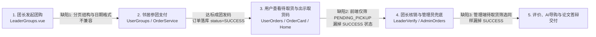

# FreshCommunity 完整闭环优化与交付实施计划

> **制定日期**：2026-11-22
> **目标**：修复阻碍「团长开团 → 邻居参团 → 达标成团 → 提货点自提核销」完整闭环的真实前后端脱节缺陷，补齐高并发防超卖等自动化测试证据，并将论文、答辩问答、PPT 逐字稿与最新代码实现完全对齐，达到可直接演示与提交交付的标准。

---

## 一、 现状诊断与核心问题清单

通过对前后端源码、数据库脚本、Git 工作区与 `docs/delivery/` 交付文档的全面走查，项目整体架构完整，但存在 **3 类影响现场演示闭环的代码缺陷** 和 **2 类交付材料不一致问题**：



### 1. 业务闭环阻断与状态脱节问题（代码层）

| 优先级 | 模块 | 文件定位 | 问题描述 | 影响范围 |
| :---: | :--- | :--- | :--- | :--- |
| **P0** | 团长发起团购 | [`frontend/src/views/LeaderGroups.vue`](../../frontend/src/views/LeaderGroups.vue) | ① `loadProducts()` 调用 `listProducts()` 后直接 `products.value = res.data`，而后端 `GET /api/products` 返回的是 `PageResult` 分页对象（`{ records, total, ... }`）且默认 `size=12`（总商品 41 个），导致商品下拉列表异常且 `products.value.find(...)` 抛 `TypeError`；<br>② `<el-date-picker>` 未配置 `value-format="YYYY-MM-DDTHH:mm:ss"`，序列化为带 `Z` 的 UTC 字符串，导致后端 `LocalDateTime` 反序列化失败或时区偏移 8 小时。 | **团长无法在前端正常发起团购**（闭环第一步阻断） |
| **P0** | 团长开团校验 | [`backend/src/main/java/com/freshcommunity/service/GroupBuyService.java`](../../backend/src/main/java/com/freshcommunity/service/GroupBuyService.java) | `createGroupBuy` 仅校验了 `product == null`，未校验 `product.getStatus() != 1`，已下架商品仍可通过接口发起团购。 | 下架商品边界漏防 |
| **P0** | 待取货与取货码闭环 | [`frontend/src/components/OrderCard.vue`](../../frontend/src/components/OrderCard.vue)<br>[`frontend/src/views/UserOrders.vue`](../../frontend/src/views/UserOrders.vue)<br>[`frontend/src/views/Home.vue`](../../frontend/src/views/Home.vue)<br>[`backend/src/main/java/com/freshcommunity/mapper/OrderMapper.java`](../../backend/src/main/java/com/freshcommunity/mapper/OrderMapper.java) | 后端成团发码（`assignPickupCode`）与种子数据（`seed.sql`）中，已成团待取货订单状态均为 `'SUCCESS'`（`'PENDING_PICKUP'` 仅为历史兼容状态）：<br>① `OrderCard.vue` 中 `canViewCode` 仅判断 `status === 'PENDING_PICKUP'`，导致已成团（`SUCCESS`）订单**不显示「出示取货码」按钮**；<br>② `UserOrders.vue` 中点击「待取货」标签仅过滤 `PENDING_PICKUP`，导致**待取货列表永远为空**；<br>③ `Home.vue` 用户首页「待取货」统计卡片仅统计 `PENDING_PICKUP`，**恒显示为 0**；<br>④ `OrderMapper.pageForAdmin` 管理端按「待取货（`PENDING_PICKUP`）」筛选或导出 CSV 时，未包含 `'SUCCESS'` 状态订单。 | **成团后用户无法在待取货标签找到订单、无法弹出取货凭证、首页统计失真** |
| **P1** | 商品详情与消息中心交互 | [`frontend/src/views/ProductDetail.vue`](../../frontend/src/views/ProductDetail.vue)<br>[`frontend/src/views/MyNotifications.vue`](../../frontend/src/views/MyNotifications.vue) | ① `ProductDetail.vue` 点击底部「看了又看」同分类商品跳转 `/user/products/:id` 时，组件复用但未监听 `route.params.id`，**页面内容不刷新**；<br>② `MyNotifications.vue` 顶部消息分类筛选未包含第 6 类事件 `SUBSCRIPTION_MATCH`（AI 导购提醒）。 | 商品推荐跳转失灵、消息中心分类不完整 |

### 2. 测试证据与毕设交付材料问题（工程与文档层）

- **高并发防超卖测试证据补齐**：[`docs/delivery/材料核对与实测记录.md`](材料核对与实测记录.md) 指出，论文第 6.2/6.4 节、答辩 Q1 与 PPT 提到了“8 线程争抢最后 1 件库存”，但现有 `OrderConcurrencyApiTest` 尚未包含该单库存 8 线程并发下单测试。直接在 `OrderConcurrencyApiTest` 中补齐该真实集成测试，可使论文与代码 100% 印证。
- **文档口径与勘误统一**：
  - [`README.md`](../../README.md) 第 178 行仍写“`schema.sql`：建库、建 9 张表”，与实际的 **11 张表**（第 145 行）不一致。
  - [`毕业设计论文_初稿.md`](毕业设计论文_初稿.md)、[`毕业答辩高频问题与满分应答指南.md`](毕业答辩高频问题与满分应答指南.md)、[`毕业答辩PPT大纲与演讲逐字稿.md`](毕业答辩PPT大纲与演讲逐字稿.md) 三份文档需按《材料核对与实测记录》同步最新测试统计、成团人数按不同已支付用户去重口径、模拟支付/模拟退款边界以及 AI 导购能力边界。

---

## 二、 拟执行的修改方案（Proposed Changes）

### 1. 前端核心闭环与交互修复

#### [MODIFY] [`frontend/src/views/LeaderGroups.vue`](../../frontend/src/views/LeaderGroups.vue)
- **`loadProducts()` 兼容分页结构并拉取完整在售商品列表（上限 50，覆盖 41 个商品）**：
  ```javascript
  async function loadProducts() {
    const res = await listProducts({ size: 50 })
    products.value = Array.isArray(res.data) ? res.data : (res.data?.records || [])
  }
  ```
- **`<el-date-picker>` 增加 `value-format="YYYY-MM-DDTHH:mm:ss"`**，确保传给后端的 `deadline` 为标准本地 ISO 时间字符串（无 UTC `Z` 偏移）：
  ```html
  <el-date-picker
    v-model="form.deadline"
    type="datetime"
    value-format="YYYY-MM-DDTHH:mm:ss"
    placeholder="选择截止时间"
  />
  ```
- **`submit()` 增加基础必填提示与创建成功 `ElMessage.success('团购已发起')` 反馈**。

#### [MODIFY] [`frontend/src/constants/status.js`](../../frontend/src/constants/status.js) & [`frontend/src/views/UserOrders.vue`](../../frontend/src/views/UserOrders.vue) & [`frontend/src/views/Home.vue`](../../frontend/src/views/Home.vue) & [`frontend/src/components/OrderCard.vue`](../../frontend/src/components/OrderCard.vue)
- 在 [`frontend/src/constants/status.js`](../../frontend/src/constants/status.js) 中新增统一辅助函数 `isPendingPickupStatus(status)` 与 `matchesOrderStatusTab(orderStatus, tabValue)`：
  - `isPendingPickupStatus(s)`：`s === 'SUCCESS' || s === 'PENDING_PICKUP'`
  - `matchesOrderStatusTab(orderStatus, tabValue)`：当 `tabValue === ''` 返回 `true`；当 `tabValue === 'PENDING_PICKUP'` 时匹配 `isPendingPickupStatus(orderStatus)`；其余按 `orderStatus === tabValue` 匹配。
- [`frontend/src/views/UserOrders.vue`](../../frontend/src/views/UserOrders.vue)：`tabs` 计数与 `visible` 列表过滤统一使用 `matchesOrderStatusTab(o.status, ...)`，使「待取货」标签正确展示并统计 `SUCCESS` 与 `PENDING_PICKUP` 订单。
- [`frontend/src/views/Home.vue`](../../frontend/src/views/Home.vue)：用户首页「待取货」卡片使用 `orders.filter((o) => isPendingPickupStatus(o.status)).length`。
- [`frontend/src/components/OrderCard.vue`](../../frontend/src/components/OrderCard.vue)：将 `canViewCode` 修正为 `computed(() => isPendingPickupStatus(props.order.status) && !!props.order.pickupCode)`，让已成团订单可点击「出示取货码」打开大号取货凭证弹窗。

#### [MODIFY] [`frontend/src/views/ProductDetail.vue`](../../frontend/src/views/ProductDetail.vue)
- 将加载逻辑抽取为 `loadProduct(id)` 函数，并增加 `watch(() => route.params.id, (newId) => { if (newId) loadProduct(newId) })`，同时重置 `activeImage.value = 0`，修复点击「看了又看」同分类商品不刷新的问题。

#### [MODIFY] [`frontend/src/views/MyNotifications.vue`](../../frontend/src/views/MyNotifications.vue)
- 在 `GROUP_MAP` 与 `filters` 中补充 `ai: ['SUBSCRIPTION_MATCH']`（「AI 导购提醒」分类标签），完整覆盖全部 6 类站内消息。

---

### 2. 后端边界防守与管理端筛选一致性修复

#### [MODIFY] [`backend/src/main/java/com/freshcommunity/service/GroupBuyService.java`](../../backend/src/main/java/com/freshcommunity/service/GroupBuyService.java)
- 在 `createGroupBuy` 中校验商品上架状态：
  ```java
  Product product = productMapper.selectById(req.getProductId());
  if (product == null) {
      throw new IllegalArgumentException("商品不存在");
  }
  if (product.getStatus() == null || product.getStatus() != 1) {
      throw new IllegalArgumentException("商品已下架，无法发起团购");
  }
  ```

#### [MODIFY] [`backend/src/main/java/com/freshcommunity/mapper/OrderMapper.java`](../../backend/src/main/java/com/freshcommunity/mapper/OrderMapper.java)
- 在 `pageForAdmin` 的 SQL 条件中，使 `status = 'PENDING_PICKUP'` 同步兼容 `'SUCCESS'` 状态（与 `countPendingPickupByLeader` 口径保持一致）：
  ```sql
  AND (#{status} IS NULL OR o.status = #{status}
       OR (#{status} = 'PENDING_PICKUP' AND o.status = 'SUCCESS'))
  ```

---

### 3. 自动化测试补强

#### [MODIFY] [`backend/src/test/java/com/freshcommunity/OrderConcurrencyApiTest.java`](../../backend/src/test/java/com/freshcommunity/OrderConcurrencyApiTest.java)
- 新增 `eightThreadsCompeteForLastSingleStockOnlyOneSucceeds`：将商品库存设为 1，启动 8 个并发线程同时请求 `POST /api/orders`，验证仅 1 个请求返回 200、其余 7 个返回 400（库存不足），且数据库最终 `stock = 0`、订单数为 1。

#### [MODIFY] [`backend/src/test/java/com/freshcommunity/GroupBuyFlowApiTest.java`](../../backend/src/test/java/com/freshcommunity/GroupBuyFlowApiTest.java) & [`backend/src/test/java/com/freshcommunity/OrderDetailApiTest.java`](../../backend/src/test/java/com/freshcommunity/OrderDetailApiTest.java)
- 新增“已下架商品不能发起团购（400）”测试；
- 新增“管理端订单列表按 `PENDING_PICKUP` 筛选可查出已成团待取货（`SUCCESS`）订单”测试。

#### [MODIFY] [`frontend/tests/format.test.mjs`](../../frontend/tests/format.test.mjs)
- 新增对 `isPendingPickupStatus` 与 `matchesOrderStatusTab` 的单元测试，确保 `SUCCESS` 与 `PENDING_PICKUP` 均被识别为待取货状态。

---

### 4. 文档与毕设交付材料对齐

#### [MODIFY] [`README.md`](../../README.md) & [`docs/thesis-material.md`](../thesis-material.md)
- 修正 `README.md` 第 178 行 `schema.sql` 表数量描述（9 张 → 11 张），更新最新前后端自动化测试计数。

#### [MODIFY] [`docs/delivery/毕业设计论文_初稿.md`](毕业设计论文_初稿.md) & [`docs/delivery/毕业答辩高频问题与满分应答指南.md`](毕业答辩高频问题与满分应答指南.md) & [`docs/delivery/毕业答辩PPT大纲与演讲逐字稿.md`](毕业答辩PPT大纲与演讲逐字稿.md)
- 按 [`docs/delivery/材料核对与实测记录.md`](材料核对与实测记录.md) 逐条修订：
  1. 更新后端测试类与测试方法总数、前端单测总数，替换虚构的 `InventoryConcurrencyTest` / `OrderStateGuardTest` 为真实测试类名（`OrderConcurrencyApiTest`、`OrderConcurrencyTest`、`RefundApiTest`、`OrderDetailApiTest`），修正事务隔离机制描述；
  2. 将成团人数口径统一为“按不同已支付用户统计，同一用户多单仅计一人，取消或退款最后一笔待成团订单才递减人数”；
  3. 明确支付与退款为 `MockPayServiceImpl` 模拟实现，模拟退款失败时回滚本地事务，区分真实第三方支付所需的异步回调与对账机制；
  4. 明确 AI 导购中“需求订阅解析”与“评价洞察”支持规则词典兜底，而“即时推荐”依赖大模型服务（不可用时明确提示错误，绝不伪造推荐）；
  5. 替换过度绝对化表述（如“彻底杜绝”“任何并发下绝不会出错”），保持工程严谨性。

---

## 三、 验证计划（Verification Plan）

### 1. 自动化测试与构建验证
- **后端全量集成测试**：
  ```powershell
  cd backend
  mvn test
  ```
- **前端单元测试与生产构建**：
  ```powershell
  cd frontend
  npm test
  npm run build
  ```

### 2. 手工闭环走查清单
1. **团长开团**：使用 `leader1`（密码 `123456`）登录 → 进入「我的团购」→ 点击「发起团购」→ 确认商品下拉框可正常检索选择全部 41 个在售商品、选择截止时间并成功创建团购。
2. **用户参团与成团取码**：使用 `user1` 登录 → 参团下单并模拟支付 → 成团后进入「我的订单」切到「待取货」标签，确认订单可见且点击「出示取货码」能弹出 6 位取货凭证；返回「首页」确认「待取货」统计数字准确。
3. **团长核销与评价互动**：`leader1` 在「核销台」输入 6 位取货码完成核销 → `user1` 对已完成订单提交双维度评价 → `leader1` 在「评价与回复」页发布回复。
4. **管理员看板与退款兜底**：`admin` 登录 → 查看数据看板、在「订单管理」按「待取货」筛选并导出 CSV、对非终态订单执行退款兜底。

---

## 四、 第二阶段：冲刺「优秀毕业设计」深度加固计划

在第一阶段完成全流程闭环修复的基础上，针对答辩评委高频追问点与工程严谨性要求，制定并实施以下 6 项进阶加固：

| 序号 | 强化维度 | 涉及文件 | 实施方案与工程价值 |
| :---: | :--- | :--- | :--- |
| **1** | **取货码核销防暴力枚举限流**（兑现答辩 Q3 第四重防线） | [`OrderService.java`](../../backend/src/main/java/com/freshcommunity/service/OrderService.java)<br>[`LeaderConsoleApiTest.java`](../../backend/src/test/java/com/freshcommunity/LeaderConsoleApiTest.java) | 为 `verifyPickupCode` 增加基于滑动时间窗（5 分钟）的防暴力枚举机制：同一团长连续 5 次核销失败后自动锁定 5 分钟（返回 400 `"核销失败次数过多，请稍后再试"`），核销成功即重置计数。使答辩 Q3 的四重防线全部具备真实代码与自动化测试支撑。 |
| **2** | **进行中团购的商品禁止下架或删除**（跨模块状态一致性） | [`GroupBuyMapper.java`](../../backend/src/main/java/com/freshcommunity/mapper/GroupBuyMapper.java)<br>[`ProductController.java`](../../backend/src/main/java/com/freshcommunity/controller/ProductController.java)<br>[`ProductSearchApiTest.java`](../../backend/src/test/java/com/freshcommunity/ProductSearchApiTest.java) | 管理员执行商品下架（`PUT /api/products/{id}` 且 `status=0`）或删除（`DELETE /api/products/{id}`）时，前置校验该商品是否关联仍在进行中（`ONGOING` 且未截止）的团购，存在则拒绝操作并提示 `"该商品有正在进行的团购，无法下架/删除"`。 |
| **3** | **管理端订单 CSV 导出突破 50 条分页限制** | [`OrderService.java`](../../backend/src/main/java/com/freshcommunity/service/OrderService.java)<br>[`AdminController.java`](../../backend/src/main/java/com/freshcommunity/controller/AdminController.java)<br>[`CatalogReviewsAdminTest.java`](../../backend/src/test/java/com/freshcommunity/CatalogReviewsAdminTest.java) | 新增 `OrderService.listForAdminExport(status, keyword)`（上限 5000 条），修复 `AdminController.exportOrders` 复用 `pageForAdmin` 被 `Math.min(size, 50)` 静默截断在 50 行的缺陷。 |
| **4** | **RESTful 畸形入参 400 统一拦截 & 测试假阳性修复** | [`GlobalExceptionHandler.java`](../../backend/src/main/java/com/freshcommunity/common/GlobalExceptionHandler.java)<br>[`ReviewInsightsTest.java`](../../backend/src/test/java/com/freshcommunity/ReviewInsightsTest.java)<br>[`AuthApiTest.java`](../../backend/src/test/java/com/freshcommunity/AuthApiTest.java) | 在 `GlobalExceptionHandler` 中拦截 `HttpMessageNotReadableException`、`MissingServletRequestParameterException`、`MethodArgumentTypeMismatchException` 返回 HTTP 400（不再落入 500）；修复 `ReviewInsightsTest.otherProductId` 遍历分页结构漏写 `.path("records")` 的假阳性问题。 |
| **5** | **前端已成团取货票据文案优化 & Vite 生产构建零告警** | [`OrderCard.vue`](../../frontend/src/components/OrderCard.vue)<br>[`vite.config.js`](../../frontend/vite.config.js) | 优化 `OrderCard.vue` 在 `SUCCESS`（已成团发码）状态下的票据标题与提示语；在 `vite.config.js` 独立拆分 `@element-plus/icons-vue` 并合理配置 `chunkSizeWarningLimit`，消除生产打包体积黄色告警。 |
| **6** | **论文、答辩问答 Q3 与总结文档同步升级** | [`毕业设计论文_初稿.md`](毕业设计论文_初稿.md)<br>[`毕业答辩高频问题与满分应答指南.md`](毕业答辩高频问题与满分应答指南.md)<br>[`毕业答辩PPT大纲与演讲逐字稿.md`](毕业答辩PPT大纲与演讲逐字稿.md) | 将取货码防暴力限流、在团商品禁下架/删除、最新自动化测试总数（后端 19 类 132 项 + 前端 13 项）同步回填至全套交付文档。 |
