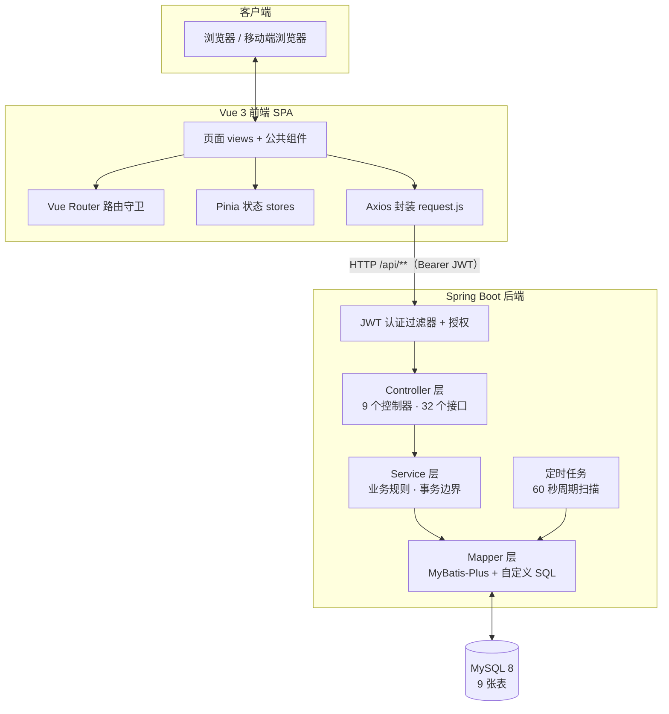
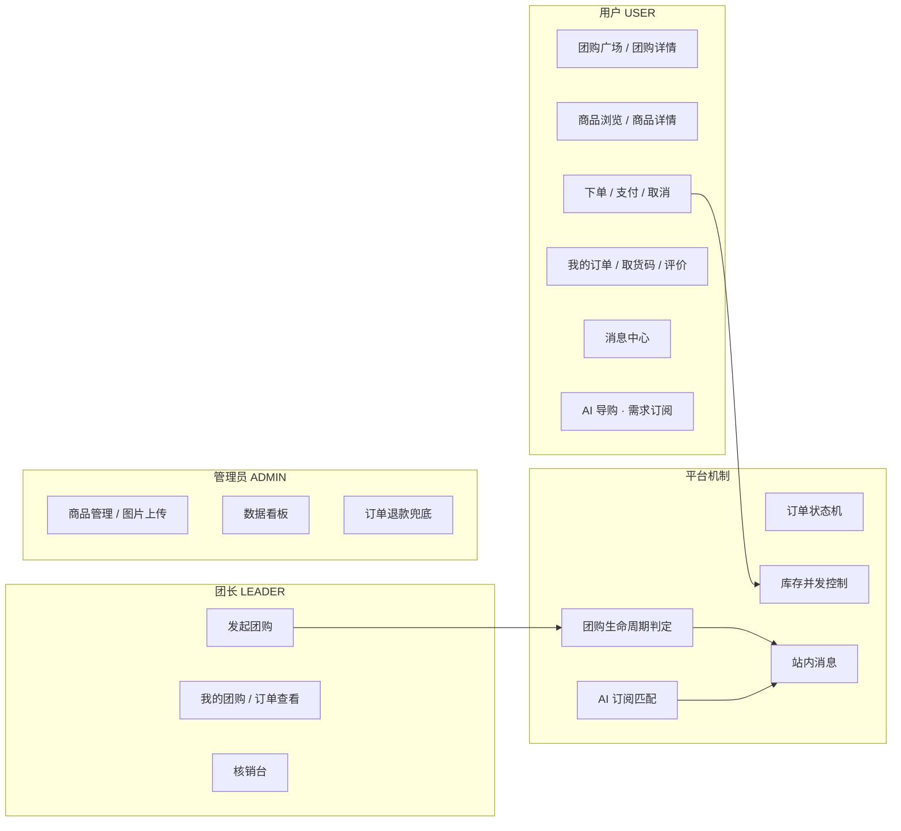
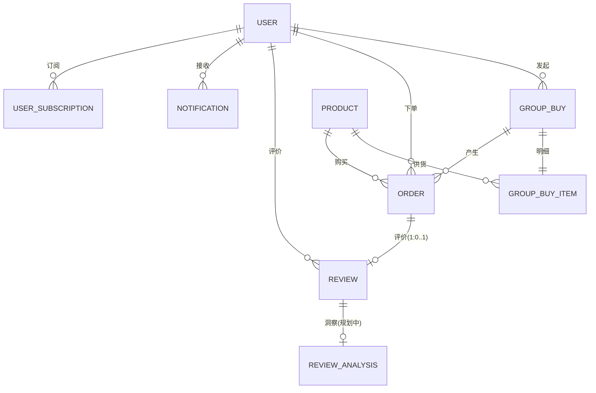
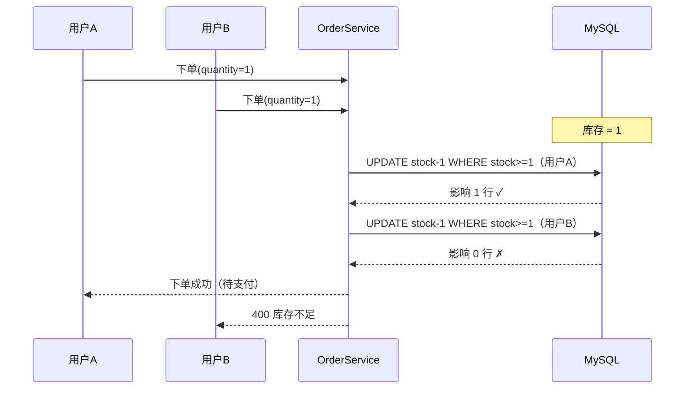
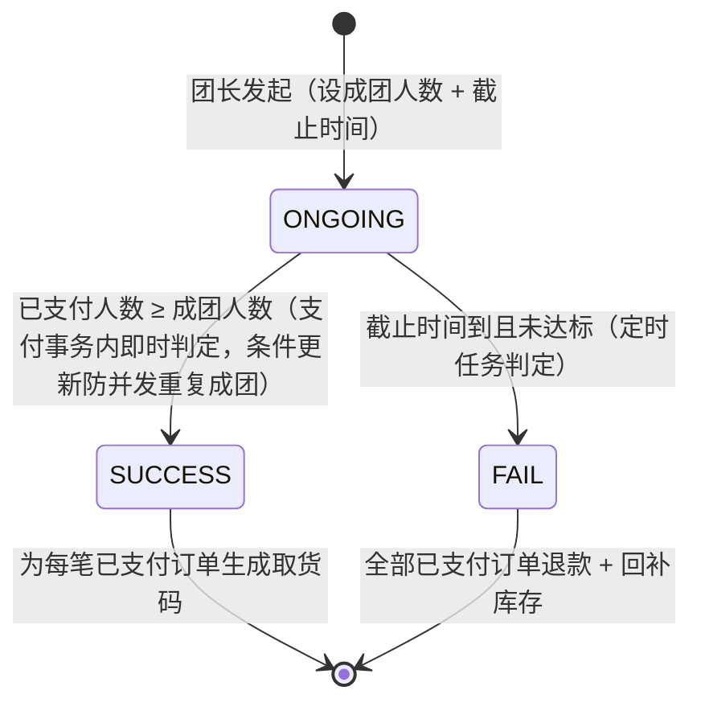
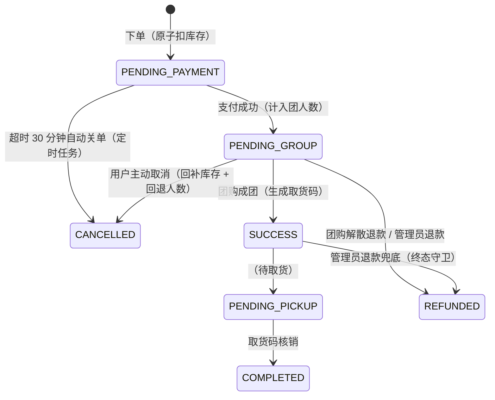
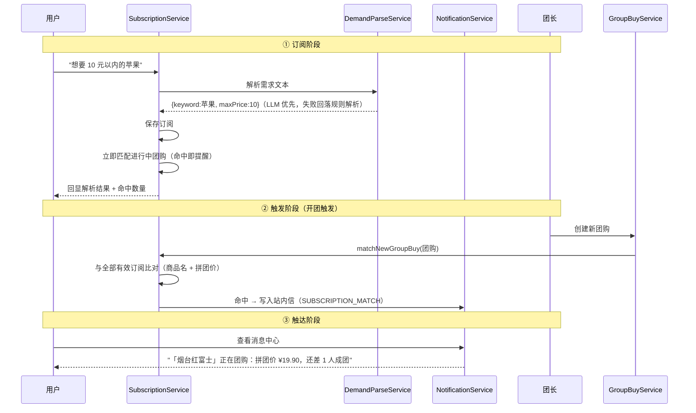
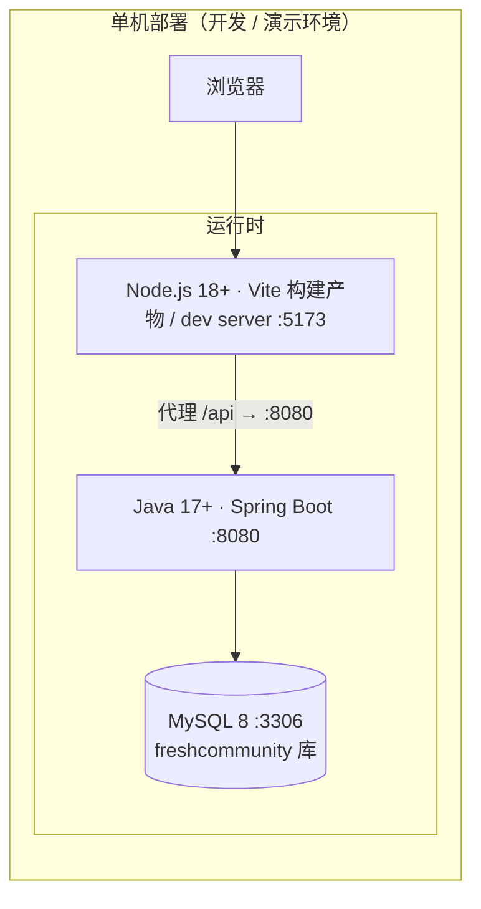

# FreshCommunity 社区生鲜团购平台 · 系统设计说明书

> **版本**：v1.0　**日期**：2026-10-14
> **用途**：开题报告「技术方案」章节素材、毕业论文「系统设计」章节底稿
> **配套文档**：《需求分析》（`docs/requirements-analysis.md`）、《实现清单》（`docs/implementation-inventory.md`）、界面设计（`docs/ui-design/`）、验证报告（`docs/verification-report.md`）

---

## 1. 引言

本节说明文档的编写目的、系统概述、术语约定与设计依据。

### 1.1 编写目的

本文档描述 FreshCommunity 社区生鲜团购平台的系统设计：总体架构、数据库、接口、关键机制、安全与部署。设计以《需求分析》中的 43 个功能点为输入，覆盖「团长开团 → 邻居参团 → 人数达标成团 → 提货点自提核销」的完整业务闭环。

### 1.2 系统概述

平台围绕社区团购交易闭环提供三角色（用户 / 团长 / 管理员）在线服务：团长发起生鲜商品限时团购；用户在线参团、模拟支付；达到成团人数即拼团成功并生成提货码，到点未达标自动解散并全额退款；用户到提货点由团长核销取货；全流程的成团、解散、超时关单、核销、退款事件由站内消息主动触达用户。平台并引入 AI 导购能力：用户以自然语言表达购物需求，系统解析为订阅条件，在新团出现时自动匹配并提醒。

### 1.3 术语约定

| 术语 | 说明 |
| --- | --- |
| 团购 / 团 | 团长发起的一期拼团活动，含参与商品、成团人数与截止时间 |
| 成团 | 已支付订单人数达到成团人数，团购判定成功 |
| 解散 | 截止时间到仍未成团，团购判定失败并退款 |
| 核销 | 团长在提货点校验取货码，将订单置为已完成 |
| 拼团价 | 开团时商品价格的快照（`price_snapshot`），即用户参团实付价格口径 |
| 订阅 | AI 导购中用户以自然语言留存的需求条件（关键词 + 价格上限） |
| 匹配 | 新开团购与订阅条件的比对过程，命中即触发提醒 |

### 1.4 设计依据与约束

- 设计目标为**单体 Web 应用**，本地一键启动，面向教学级部署与答辩演示；
- 约束：不引入 Redis / 消息队列等中间件；支付以模拟实现（预留扩展点）；外部 LLM 服务可选接入且必须可降级；
- 依据：OpenSpec 规格基线（9 个 capability / 35 条需求 / 57 个验收场景）与历次实测验证结论。

---

## 2. 总体设计

本节从设计目标与原则、系统架构、技术选型与功能模块划分四个方面给出系统的总体设计。

### 2.1 设计目标与原则

| 原则 | 落地表现 |
| --- | --- |
| **正确性优先** | 交易核心（库存、人数、金额）以数据库原子操作与状态机守卫保证；关键缺陷（虚假成团、重复退款）已修复并纳入回归测试 |
| **状态透明** | 团购 3 态、订单 7 态显式建模，状态只能沿合法路径流转 |
| **单一职责分层** | Controller / Service / Mapper 分层，定时任务独立成组 |
| **可扩展** | 支付以 `PayService` 接口隔离；AI 解析以 `DemandParseService` 接口隔离（规则实现当前可用，LLM 实现可插入）；通知类型枚举化管理 |
| **可用性降级** | 外部依赖（LLM）不可用时功能以规则链路兜底，核心交易不依赖任何外部服务 |

### 2.2 系统架构

采用前后端分离的分层单体架构：



**分层职责**：

- **前端 SPA**：单页应用承载三角色界面；路由守卫控制登录态；Axios 统一携带 JWT、统一处理 401；设计系统（tokens + 公共组件）保证视觉一致性；
- **Controller 层**：接口路由、参数校验（Jakarta Validation）、统一返回包装 `{code, msg, data}`；
- **Service 层**：业务规则与事务边界（`@Transactional`），订单状态机、成团判定、库存扣减、订阅匹配等核心逻辑所在；
- **Mapper 层**：MyBatis-Plus 基础 CRUD + 自定义原子 SQL（库存扣减、条件更新、超时扫描）；
- **定时任务**：独立组件，60 秒周期处理「到期团购判定」与「待支付超时关单」两类扫描型业务。

### 2.3 技术选型

| 层 | 技术 | 版本 | 选型理由（含备选对比） |
| --- | --- | --- | --- |
| 后端框架 | Spring Boot | 3.2.5（Java 17+） | 生态成熟、资料丰富，利于开发与论文写作 |
| ORM | MyBatis-Plus | 3.5.5 | 需要编写原子扣减、条件更新等精细 SQL，MyBatis 比 JPA 更直观可控；Plus 提供逻辑删除与基础 CRUD 提效 |
| 数据库 | MySQL | 8+ | 事务与行锁能力满足并发控制需求；备选 Redis 预扣方案因单机场景收益有限且增加部署复杂度被否决 |
| 认证 | Spring Security + JWT | jjwt 0.12.5 | 前后端分离下的无状态鉴权；角色鉴权使用注解式 `@PreAuthorize` |
| 前端框架 | Vue 3 + Vite | 3.4 / 5 | 组合式 API + 快速构建；与 Element Plus 生态契合 |
| UI 组件 | Element Plus | 2.6 | 通过 CSS 变量覆盖实现品牌换肤 |
| 状态管理 | Pinia | 2.1 | 轻量、类型友好 |
| 定时调度 | Spring @Scheduled | — | 单体应用内置调度，无需引入任务框架 |
| AI 解析 | OpenAI 兼容 HTTP 接口（可插拔） | — | 以接口隔离实现；当前为规则实现，LLM 实现可插入且失败可降级 |

### 2.4 功能模块划分



| 模块 | 功能要点 | 对应用户需求编号 |
| --- | --- | --- |
| 用户与权限 | 注册 / 登录 / JWT / 角色隔离 / 提货点资料 | FR-1-1 ~ FR-1-4 |
| 商品管理 | 上架 / 编辑 / 浏览 / 图片上传 | FR-2-1 ~ FR-2-4 |
| 团购活动 | 发起 / 参团 / 模拟支付 / 提前成团 / 到点解散 | FR-3-1 ~ FR-3-6 |
| 库存管理 | 原子扣减 / 不足拦截 / 回补 | FR-4-1 ~ FR-4-3 |
| 订单生命周期 | 状态机 / 取消 / 超时关单 / 取货码 / 退款兜底 | FR-5-1 ~ FR-5-6 |
| 提货核销 | 输码核销 / 防重复 / 仅限本团 | FR-6-1 ~ FR-6-3 |
| 数据看板 | 今日订单 / 成团统计（扩展项规划中） | FR-7-1 ~ FR-7-3 |
| 评价体系 | 资格 / 内容 / 入口 / 汇总 / 展示 | FR-8-1 ~ FR-8-5 |
| 站内消息 | 事件通知 / 可见性 / 未读计数 | FR-9-1 ~ FR-9-4 |
| 界面与交互 | 设计系统 / 用户端主链路（已交付）；团长、管理端与移动端（规划中） | FR-10-1 ~ FR-10-5 |
| AI 导购 | 需求订阅 / 匹配提醒 / 解析降级 / 评价洞察（第二批） | FR-11（新增） |

---

## 3. 数据库设计

本节给出数据库的设计原则、实体关系模型、各表结构详表以及关键约束与索引的设计说明。

### 3.1 设计原则

- 逻辑删除统一使用 `deleted` 字段（MyBatis-Plus `@TableLogic`），业务查询自动过滤；
- 金额使用 `DECIMAL(10,2)`，避免浮点误差；
- 交易表冗余必要外键 ID（如订单直存 `product_id`、`group_buy_id`），减少运行期连表；
- 唯一性约束下沉到数据库（用户名唯一、一单一评、取货码索引），并发场景由数据库兜底；
- 状态字段使用语义化字符串枚举，可读性与可维护性优先。

### 3.2 实体关系（ER 图）



### 3.3 表结构详表

> 共 9 张表：8 张已建成（`db/schema.sql`），`review_analysis` 为 AI 导购第二批（评价洞察）规划表。

**（1）user —— 用户表**

| 字段 | 类型 | 约束 | 说明 |
| --- | --- | --- | --- |
| id | BIGINT | PK, AUTO | 主键 |
| username | VARCHAR(64) | NOT NULL, UNIQUE | 登录名 |
| password | VARCHAR(128) | NOT NULL | BCrypt 哈希 |
| role | VARCHAR(20) | NOT NULL | USER / LEADER / ADMIN |
| pickup_point_name | VARCHAR(128) | | 团长提货点名称 |
| pickup_point_address | VARCHAR(255) | | 团长提货点地址 |
| created_at / updated_at | DATETIME | | 时间戳 |
| deleted | TINYINT | NOT NULL, DEFAULT 0 | 逻辑删除 |

**（2）product —— 商品表**：id、name(VARCHAR 128)、price(DECIMAL 10,2)、stock(INT)、image_url(VARCHAR 255)、status(TINYINT: 0 下架 1 上架)、created_at/updated_at、deleted。

**（3）group_buy —— 团购活动表**

| 字段 | 类型 | 说明 |
| --- | --- | --- |
| id | BIGINT PK | 主键 |
| leader_id | BIGINT | 发起团长 |
| title | VARCHAR(128) | 团购标题 |
| target_count | INT | 成团人数 |
| deadline | DATETIME | 截止时间 |
| status | VARCHAR(20) | ONGOING / SUCCESS / FAIL |
| member_count | INT | 已支付人数（成团判定依据） |
| 索引 | | `idx_status_deadline(status, deadline)`（扫描优化） |

**（4）group_buy_item —— 团购商品关联表**：id、group_buy_id、product_id、price_snapshot(DECIMAL 10,2，开团时价格快照)、created_at、deleted。

**（5）order —— 订单表**

| 字段 | 类型 | 说明 |
| --- | --- | --- |
| id / order_no | BIGINT / VARCHAR(64) UNIQUE | 主键 / 订单号 |
| user_id / group_buy_id / product_id | BIGINT | 归属与关联 |
| quantity / amount | INT / DECIMAL(10,2) | 数量 / 金额（= 拼团价 × 数量） |
| status | VARCHAR(20) | 7 态状态机（见 §5.3） |
| pickup_code | VARCHAR(32) | 6 位取货码（成团时生成） |
| pay_time / created_at / updated_at / deleted | | 时间与逻辑删除 |
| 索引 | | order_no、user_id、group_buy_id、pickup_code |

**（6）review —— 评价表**：id、order_id(UNIQUE `uk_order_id`，一单一评的数据库兜底)、user_id、product_id、leader_id、product_score(TINYINT 1-5)、leader_score(TINYINT 1-5)、content(VARCHAR 500)、时间戳、deleted。

**（7）notification —— 站内消息表**：id、user_id、type(VARCHAR 32：GROUP_SUCCESS / GROUP_FAILED / ORDER_TIMEOUT / PICKUP_DONE / REFUNDED / SUBSCRIPTION_MATCH)、title(VARCHAR 128)、content(VARCHAR 500)、ref_order_id、is_read(TINYINT)、时间戳、deleted、`idx_user_read(user_id, is_read)`。

**（8）user_subscription —— 需求订阅表（AI 导购）**：id、user_id、keyword(VARCHAR 64)、max_price(DECIMAL 10,2 可空)、source_text(VARCHAR 255，原始输入)、created_at、deleted、`idx_user(user_id)`。

**（9）review_analysis —— 评价洞察表（规划中）**：id、review_id(UNIQUE)、sentiment(VARCHAR 16：POSITIVE/NEGATIVE/NEUTRAL)、tags(VARCHAR 255)、analyzed_at、deleted。

### 3.4 关键约束与索引设计说明

| 设计点 | 目的 |
| --- | --- |
| `uk_order_id`（review） | 并发重复评价由数据库唯一索引兜底，应用层异常转 400 |
| `idx_status_deadline`（group_buy） | 定时任务按「状态 + 截止时间」扫描，走索引 |
| `idx_pickup_code`（order） | 核销按码查询走索引；码生成时查重保证唯一 |
| 逻辑删除统一约定 | 所有业务查询自动过滤，删除可追溯、可回滚 |

---

## 4. 接口设计

本节说明接口的设计规范与总体清单，并给出典型接口的请求与响应示例。

### 4.1 接口规范

- **风格**：REST 风格，资源路径 + HTTP 方法语义（GET 查询 / POST 创建与动作 / PUT 更新 / DELETE 删除）；
- **统一返回**：`{ "code": 200, "msg": "success", "data": ... }`；业务异常由全局异常处理器映射为 400/401/403/404/405；
- **鉴权**：`Authorization: Bearer <JWT>`；控制器以 `@RequestAttribute("userId")` 获取当前用户；角色限制用 `@PreAuthorize`，数据归属在 Service 层校验；
- **参数校验**：请求 DTO 使用 Jakarta Validation 注解，失败返回中文提示。

### 4.2 接口清单（32 个）

| 模块 | 方法与路径 | 权限 | 说明 |
| --- | --- | --- | --- |
| 基础 | GET `/api/health` | 公开 | 健康检查 |
| 认证 | POST `/api/auth/register` · `/api/auth/login` | 公开 | 注册 / 登录（返回 JWT） |
| 认证 | GET `/api/auth/me` | 登录 | 当前用户信息 |
| 商品 | GET `/api/products` · `/api/products/{id}` | 登录 | 列表 / 详情（含评分汇总） |
| 商品 | POST / PUT / DELETE `/api/products/**` | ADMIN | 增 / 改 / 删 |
| 商品 | POST `/api/upload` | ADMIN | 图片上传（≤5MB） |
| 团购 | GET `/api/group-buys` · `/{id}` | 登录 | 进行中列表 / 详情 |
| 团购 | GET `/api/group-buys/mine` | LEADER | 我发起的团购 |
| 团购 | POST `/api/group-buys` | LEADER | 发起团购（创建后触发订阅匹配） |
| 团购 | GET `/api/group-buys/{id}/orders` | LEADER | 本团订单（归属校验） |
| 订单 | POST `/api/orders` | 登录 | 下单（原子扣库存） |
| 订单 | POST `/api/orders/{id}/pay` · `/{id}/cancel` | 登录 | 模拟支付 / 取消 |
| 订单 | GET `/api/orders/mine` | 登录 | 我的订单 |
| 订单 | POST `/api/orders/verify` | LEADER | 取货码核销 |
| 订单 | POST `/api/orders/{id}/refund` | ADMIN | 退款兜底 |
| 评价 | POST `/api/reviews` · GET `/mine` · `/product/{id}` | 登录 | 提交 / 我的 / 商品评价与汇总 |
| 消息 | GET `/api/notifications` · `/unread-count` | 登录 | 列表 / 未读数 |
| 消息 | POST `/api/notifications/{id}/read` · `/read-all` | 登录 | 标记已读 |
| 看板 | GET `/api/admin/dashboard` | ADMIN | 今日订单 / 成团数 |
| **AI 导购** | POST `/api/subscriptions` | 登录 | 创建订阅（解析 + 立即匹配） |
| **AI 导购** | GET `/api/subscriptions` | 登录 | 我的订阅列表 |
| **AI 导购** | DELETE `/api/subscriptions/{id}` | 登录 | 取消订阅 |

### 4.3 典型接口示例：下单

请求：`POST /api/orders?groupBuyId=12&quantity=2`（Bearer JWT）

响应（成功）：
```json
{ "code": 200, "msg": "success", "data": { "id": 41, "orderNo": "FC20261014...", "status": "PENDING_PAYMENT", "amount": 53.80 } }
```

响应（库存不足）：
```json
{ "code": 400, "msg": "库存不足", "data": null }
```

---

## 5. 关键机制设计

> 本章为系统的技术核心，也是论文「关键技术」素材。

### 5.1 库存并发控制（防超卖）

**问题**：多个用户并发抢购同一商品时，「先查询库存、再扣减」的朴素实现会产生超卖（竞态窗口）。

**方案**：将扣减下沉为一条原子 SQL，以数据库行锁保证原子性：

```sql
UPDATE product SET stock = stock - #{quantity}
WHERE id = #{productId} AND stock >= #{quantity}
```

受影响行数为 0 即判定库存不足并回滚订单创建（同一本地事务）。

**备选方案对比**：

| 方案 | 并发安全 | 性能 | 复杂度 | 结论 |
| --- | --- | --- | --- | --- |
| 先查后改（无锁） | ✗ 超卖 | — | 低 | 否决 |
| 悲观锁 `SELECT ... FOR UPDATE` | ✓ | 低（锁等待） | 中 | 备选 |
| **原子扣减（本方案）** | ✓ | 高（无应用锁） | 低 | **采用** |
| Redis 预扣 + Lua | ✓ | 最高 | 高（引入中间件） | 单机场景收益有限，暂不采用 |

**验证结论**：库存为 1 时 8 个并发下单请求，仅 1 单成功、其余明确失败，库存归零不超卖（实测断言见验证报告）。



### 5.2 团购生命周期

团购 3 态（ONGOING / SUCCESS / FAIL）的判定逻辑：



- **提前成团**：支付成功的事务内同步检查「已支付人数 ≥ 成团人数」，达标立即成团（低延迟）；成团状态变更使用条件更新（`WHERE status='ONGOING'`），并发支付同时达标时只成功一次；
- **兜底扫描**：定时任务每分钟扫描到期团购，未达标置 FAIL 并批量退款；两种判定路径互补，任一路径先到即生效。

### 5.3 订单状态机

订单 7 态，状态只能沿合法路径流转：



**流转规则要点**：

| 规则 | 说明 |
| --- | --- |
| 待成团可取消 | 取消时同时回补库存并**递减团购人数**（防止「虚假成团」） |
| 成团后不可取消 | SUCCESS 及之后状态拒绝用户取消 |
| 终态守卫 | 已取消/已退款/已完成订单拒绝重复 refund/cancel（条件更新，防重复回补库存） |
| 超时关单 | 待支付超 30 分钟由定时任务关闭，订单不计入团购人数 |

### 5.4 定时任务设计

单一调度组件，60 秒周期，两类扫描：

| 任务 | 扫描条件 | 处理动作 |
| --- | --- | --- |
| 到期团购处理 | `status=ONGOING AND deadline <= NOW()` | 达标 → 成团；未达标 → 解散退款 |
| 待支付超时关单 | `status=PENDING_PAYMENT AND created_at <= NOW()-30min` | 关单 + 回补库存 + 通知 |

设计要点：任务幂等（处理前再次校验状态），异常不影响下轮执行；判定延迟 ≤60 秒，对业务可接受。

### 5.5 数据一致性设计

| 一致性问题 | 设计措施 |
| --- | --- |
| 库存与订单 | 扣减与订单创建同一本地事务，失败整体回滚 |
| 人数与订单 | 支付 +1 / 取消 −1 / 解散退款 −1，三条路径对称设计（虚假成团缺陷修复后固化） |
| 重复成团 | 团购状态变更使用条件更新（期望状态作为 WHERE 条件） |
| 重复退款 | 终态守卫：仅非终态订单可退款，回补库存仅执行一次 |
| 通知与状态 | 通知在业务事务内同步写入，保证「状态已变则消息必达」 |
| 评价重复 | `uk_order_id` 唯一索引兜底 |

### 5.6 AI 导购机制（需求订阅与智能提醒）

**目标**：把「人找团」升级为「团找人」——用户以自然语言表达需求，系统解析为结构化订阅，在新团出现时自动匹配提醒。

**三段式设计**：



**设计要点**：

| 设计点 | 方案 |
| --- | --- |
| 解析可插拔 | `DemandParseService` 接口：规则实现（当前）与 LLM 实现（可插入）统一入口；LLM 超时/异常/结果不合法时回落规则解析 |
| 匹配规则 | 商品名包含关键词（子串）+ 拼团价 ≤ 价格上限（上限可空） |
| 双触发点 | 订阅创建时（扫已有团）+ 开团时（扫全部订阅）；两触发路径的团购集合互斥，天然不重复提醒 |
| 触达通道 | 复用站内消息体系（新增 `SUBSCRIPTION_MATCH` 类型），与业务同事务 |
| 规划扩展 | 评价洞察（评价文本 → 情感与标签 → 展示与提醒摘要），分析走定时批量任务 |

---

## 6. 安全设计

| 维度 | 设计 | 说明 |
| --- | --- | --- |
| 认证 | JWT 无状态鉴权 | 登录/注册/健康检查放行，其余接口一律要求有效 token；前端 401 统一跳转登录 |
| 密码 | BCrypt 哈希存储 | `$2a$10$` 强度；接口不返回密码字段 |
| 授权 | 角色 + 数据归属双层 | 角色用 `@PreAuthorize`（ADMIN/LEADER 接口）；归属在 Service 校验（团长只能管理自己的团购/核销本团订单；用户只能操作自己的订单、订阅、消息） |
| 注入防护 | MyBatis 参数化 | 全量参数绑定，无拼接 SQL |
| 上传控制 | 管理员限定 + 大小限制 | `@PreAuthorize("hasRole('ADMIN')")`，单图 ≤5MB |
| 消息隔离 | `user_id` 条件下沉 | 消息查询与更新语句均带归属条件，从 SQL 层保证他人不可读写 |
| 已知限制 | JWT 无法主动失效 | 教学场景可接受；生产可引入黑名单或短 token + 刷新机制 |

---

## 7. 界面设计

界面以「让『跟不跟这个团』在 1 秒内被看懂」为设计目标，已完成设计系统（品牌 token + 6 个公共组件 + 状态映射）与用户端主链路页面；团长端、管理端与响应式移动端为规划项。

- 设计规范与双端高保真原型：`docs/ui-design/design-spec.md`、`prototype.html`（桌面端 11 界面）、`prototype-mobile.html`（移动端 11 屏）；
- 设计要点：进度优先（进度条 + 倒计时为视觉重心）、状态透明（7 态徽章与时间轴）、取货码票据化（全流程终点凭证）、角色自适应导航。

---

## 8. 部署设计



**环境要求与启动流程**：

| 项 | 说明 |
| --- | --- |
| 环境 | Java 17+、Maven 3.8+、Node.js 18+、MySQL 8+ |
| 初始化 | `mysql --default-character-set=utf8mb4 < db/schema.sql`（建库建表）→ `db/seed.sql`（演示数据集，可重复执行） |
| 后端启动 | `DB_PASSWORD=<密码> mvn spring-boot:run`（数据库口令经环境变量注入，不入库不入仓） |
| 前端启动 | `npm install && npm run dev`（Vite 代理 /api 至 8080） |
| 测试 | `DB_PASSWORD=<密码> mvn test`（独立测试库 `freshcommunity_test`，37 个集成用例） |
| 部署形态 | 单体单机；生产化建议见 §6 已知限制与各节演进项 |

---

## 9. 附录

本附录汇总设计决策的溯源索引、验证与质量资产以及文档版本记录。

### 9.1 设计决策记录索引

| 决策 | 记录位置 |
| --- | --- |
| 框架组合 / 认证 / 防超卖 / 定时判定 / 取货码 / 支付扩展点 | `openspec/changes/archive/2026-10-11-mvp-group-buying/design.md` |
| 评价资格 / 通知同事务 / 冗余存储 / 实时聚合 | `openspec/changes/archive/2026-10-11-reviews-and-notifications/design.md` |
| AI 导购：解析降级链 / 订阅表 / 双触发 / 洞察异步 | `openspec/changes/ai-shopping-assistant/design.md` |

### 9.2 验证与质量资产

- 规格基线：9 capability / 35 requirement / 57 scenario（`openspec/specs/`）；
- 集成测试：37 个用例（4 大类 + AI 导购，`backend/src/test/`）；
- 实测报告：MVP 规格符合性 48 项断言（`docs/verification-report.md`）。

### 9.3 版本记录

| 版本 | 日期 | 说明 |
| --- | --- | --- |
| v1.0 | 2026-10-14 | 首版：总体 / 数据库 / 接口 / 关键机制 / 安全 / 部署设计 |

---

## 参考资料

[1] 张海藩, 牟永敏. 软件工程导论（第 6 版）[M]. 北京: 清华大学出版社, 2013.
[2] 王珊, 萨师煊. 数据库系统概论（第 5 版）[M]. 北京: 高等教育出版社, 2014.
[3] Spring Boot Reference Documentation [EB/OL]. VMware Tanzu. https://docs.spring.io/spring-boot/
[4] Vue.js 官方文档 [EB/OL]. https://cn.vuejs.org/
[5] MySQL 8.0 Reference Manual [EB/OL]. Oracle. https://dev.mysql.com/doc/
[6] MyBatis-Plus 官方文档 [EB/OL]. https://baomidou.com/
[7] OpenSpec: Specification-Driven Development for AI Coding [EB/OL]. https://github.com/Fission-AI/OpenSpec
