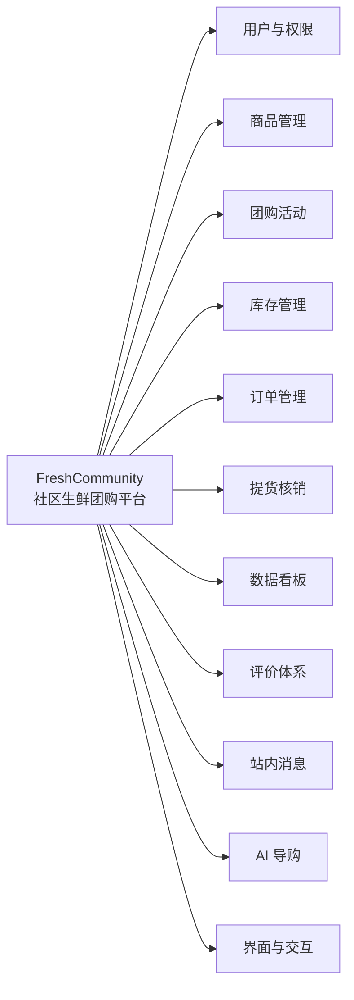

# FreshCommunity 系统功能说明

> **用途**：开题材料「系统功能」分册 / 毕业论文「系统功能」素材
> **对应关系**：功能编号与《需求分析》一致；系统设计细节见《系统设计说明书》

---

## 一、系统概述

FreshCommunity（社区生鲜团购平台）是一个面向「用户 / 团长 / 管理员」三种角色的在线团购系统，实现社区团购「**团长开团 → 邻居参团 → 人数达标成团 → 提货点自提核销**」的完整交易闭环：团长发起生鲜商品限时团购，用户在线参团并模拟支付，达到成团人数即拼团成功并生成提货码，到点未达标自动解散并全额退款；用户到提货点由团长核销取货。平台同时提供商品管理、数据看板、评价体系、站内消息等配套功能，并以 AI 导购（自然语言需求订阅与智能提醒）作为特色能力。

---

## 二、角色与功能边界

| 角色 | 定位 | 核心能力 |
| --- | --- | --- |
| **用户（USER）** | 社区居民、参团购物者 | 浏览商品与团购、参团下单与支付、查看订单与取货码、取消订单、评价商品与团长、接收站内消息、使用 AI 导购订阅需求 |
| **团长（LEADER）** | 社区提货点经营者、团购发起者 | 自助注册（含提货点资料）、发起团购、查看名下团购与订单、输入取货码核销 |
| **管理员（ADMIN）** | 平台运营者 | 商品维护（上架 / 编辑 / 图片上传）、数据看板、订单退款兜底 |

---

## 三、功能模块总览

系统共 11 个功能模块：

| 模块 | 一句话定位 | 主要使用角色 |
| --- | --- | --- |
| 用户与权限 | 三种角色的注册登录与权限隔离 | 全部 |
| 商品管理 | 生鲜商品的维护与浏览 | 管理员维护 / 全部浏览 |
| 团购活动 | 团购的发起、参与与生命周期判定 | 团长 / 用户 |
| 库存管理 | 并发安全的库存扣减与回补 | 系统机制（用户与系统交互触发） |
| 订单管理 | 订单状态机全生命周期 | 用户 / 管理员 |
| 提货核销 | 取货码生成与核销 | 团长 / 用户 |
| 数据看板 | 平台当日运营概况 | 管理员 |
| 评价体系 | 商品与团长的双维度评价 | 用户（发布）/ 全部（浏览） |
| 站内消息 | 业务事件主动触达 | 全部（接收） |
| AI 导购 | 自然语言需求订阅与智能提醒 | 用户 |
| 界面与交互 | 三角色界面与设计系统 | 全部 |

---

## 四、功能明细

### 4.1 用户与权限（FR-1）

| 编号 | 功能 | 说明 |
| --- | --- | --- |
| FR-1-1 | 自助注册 | 用户与团长可自助注册：用户名唯一校验、密码加密存储；团长注册须填写提货点资料；不支持自助注册管理员 |
| FR-1-2 | 登录与身份识别 | 账号密码登录，签发令牌标识身份与角色；提供当前用户信息查询 |
| FR-1-3 | 角色权限隔离 | 每个角色只能访问其功能范围：用户浏览与下单、团长管理自己名下团购与核销、管理员商品管理与兜底操作，越权请求被拒绝 |
| FR-1-4 | 团长提货点资料 | 团长资料包含提货点名称与地址，用户浏览团购详情时展示对应提货点，便于自提 |

### 4.2 商品管理（FR-2）

| 编号 | 功能 | 说明 |
| --- | --- | --- |
| FR-2-1 | 商品上架 | 管理员录入商品：名称、价格、库存、图片；必填校验，字段缺失拒绝提交 |
| FR-2-2 | 商品编辑 | 修改名称 / 价格 / 库存 / 图片，修改即时生效 |
| FR-2-3 | 商品浏览 | 所有角色可浏览商品列表与详情（价格、图片、剩余库存、评分汇总），支持关键词搜索 |
| FR-2-4 | 商品图片上传 | 管理员上传商品图片，限制单图大小，上传后自动关联 |

### 4.3 团购活动（FR-3）

| 编号 | 功能 | 说明 |
| --- | --- | --- |
| FR-3-1 | 发起团购 | 团长选择商品、设置成团人数与截止时间发起团购；非法参数（过去时间、非正人数）被拒绝 |
| FR-3-2 | 参团下单 | 用户对进行中的团购选择数量下单；已成团 / 已解散 / 已过期的团购不可参与 |
| FR-3-3 | 模拟支付 | 用户确认支付后订单状态流转并计入团购人数；预留真实支付渠道扩展点 |
| FR-3-4 | 提前成团 | 已支付人数达到成团人数的瞬间即时成团：关闭下单、为每笔订单生成取货码；并发场景只成团一次 |
| FR-3-5 | 到点解散退款 | 截止时间仍未达标：自动解散，全部已支付订单全额退款、库存回补；截止后不再接受下单 |
| FR-3-6 | 团长查看名下团购 | 团长查看自己发起的全部团购及参与人数、订单列表；他人无权查看 |

### 4.4 库存管理（FR-4）

| 编号 | 功能 | 说明 |
| --- | --- | --- |
| FR-4-1 | 下单原子扣减 | 下单以数据库原子操作扣减库存，多人并发抢购不超卖 |
| FR-4-2 | 库存不足拦截 | 购买数量超过剩余库存时拒绝下单并明确提示 |
| FR-4-3 | 库存回补 | 订单取消、超时关单、团购解散退款三种场景自动回补库存 |

### 4.5 订单管理（FR-5）

| 编号 | 功能 | 说明 |
| --- | --- | --- |
| FR-5-1 | 订单状态机 | 7 种状态（待支付 / 待成团 / 已成团 / 待取货 / 已完成 / 已取消 / 已退款）合法流转，非法变更被拒绝 |
| FR-5-2 | 待成团可取消 | 用户可取消待成团订单：退款、库存回补、团购人数同步回退 |
| FR-5-3 | 成团后不可取消 | 已成团 / 已核销订单拒绝用户取消 |
| FR-5-4 | 待支付超时关单 | 下单后限定时间内未支付，系统自动关闭订单并回补库存 |
| FR-5-5 | 取货码 | 成团时为每笔订单生成唯一 6 位数字取货码，用户在订单页随时查看 |
| FR-5-6 | 管理员退款兜底 | 管理员对异常订单手动退款（退款后回退人数与库存），已完成 / 已退款订单拒绝重复退款 |

### 4.6 提货核销（FR-6）

| 编号 | 功能 | 说明 |
| --- | --- | --- |
| FR-6-1 | 输码核销 | 团长在核销页面输入 6 位取货码完成核销，订单流转为已完成 |
| FR-6-2 | 防重复核销 | 已核销的取货码不可再次核销 |
| FR-6-3 | 仅限本团订单 | 团长只能核销自己名下团购的订单，跨团取货码无效 |

### 4.7 数据看板（FR-7）

| 编号 | 功能 | 说明 |
| --- | --- | --- |
| FR-7-1 | 今日订单数 | 展示当日创建订单总数 |
| FR-7-2 | 今日成团数 | 展示当日成团团购总数 |
| FR-7-3 | 看板扩展（规划） | 成交额、注册用户、趋势与状态分布（设计稿已预留） |

### 4.8 评价体系（FR-8）

| 编号 | 功能 | 说明 |
| --- | --- | --- |
| FR-8-1 | 评价资格 | 仅已完成（已核销）订单可评价，一单一评；其他状态与重复评价被拒绝 |
| FR-8-2 | 评价内容 | 商品与团长双维度评分（1–5 星）必填，文字评论可选 |
| FR-8-3 | 订单页评价入口 | 已完成且未评价的订单展示「去评价」入口，评价后显示已评价 |
| FR-8-4 | 评分汇总 | 商品与团长各自实时汇总平均分与评价条数；无评价时不显示误导性 0 分 |
| FR-8-5 | 评价展示 | 商品详情向所有用户展示评价列表与评分，评价只读不可被他人修改删除 |

### 4.9 站内消息（FR-9）

| 编号 | 功能 | 说明 |
| --- | --- | --- |
| FR-9-1 | 团购结果通知 | 成团 / 解散事件自动通知相关订单用户 |
| FR-9-2 | 订单状态变更通知 | 超时关单、核销成功、退款三类事件自动通知订单用户 |
| FR-9-3 | 消息仅本人可见 | 用户只能查看与操作自己的消息 |
| FR-9-4 | 未读计数与标记已读 | 未读数角标；支持单条已读与一键全部已读 |

### 4.10 AI 导购（FR-11）

| 编号 | 功能 | 说明 |
| --- | --- | --- |
| FR-11-1 | 自然语言需求订阅 | 用户以一句话描述购物需求（如"想要 10 元以内的苹果"），系统解析为结构化条件（关键词 + 价格上限）并回显确认；无法识别时提示换一种说法 |
| FR-11-2 | 开团匹配提醒 | 新团购创建时自动与全部有效订阅比对，命中即向订阅用户发送站内提醒（含商品名、拼团价、成团进度） |
| FR-11-3 | 订阅即有货 | 用户订阅成功的瞬间即扫描已有进行中团购，命中立即提醒 |
| FR-11-4 | 订阅管理 | 用户查看 / 取消自己的订阅，仅本人可操作 |
| FR-11-5 | 解析降级 | 智能解析采用「大模型优先、规则兜底」的可降级设计，外部服务不可用时常见表述仍可正常订阅 |
| FR-11-6 | 评价洞察（规划） | 对评价文本自动分析（情感与关键词标签），用于口碑展示与提醒摘要增强 |

### 4.11 界面与交互（FR-10）

| 编号 | 功能 | 说明 |
| --- | --- | --- |
| FR-10-1 | 设计系统 | 品牌色彩体系、状态映射规范、公共组件（状态徽章 / 团购卡片 / 订单卡片等） |
| FR-10-2 | 用户端界面 | 团购广场、团购详情、商品浏览与详情、我的订单（取货码票据 / 状态时间轴）、消息中心 |
| FR-10-3 | 团长端界面（规划） | 我的团购（经营数据 / 差几人提示）、核销台（专注模式） |
| FR-10-4 | 管理端界面（规划） | 数据看板、商品管理（搜索筛选 / 库存可视化） |
| FR-10-5 | 响应式移动端（规划） | 移动端适配（断点布局 + 底部导航），设计稿已就绪 |

---

## 五、典型业务流程

**流程一：参团到提货（主链路）**
用户浏览团购广场 → 打开团购详情（进度 / 倒计时 / 提货点）→ 选择数量下单 → 模拟支付 → 人数达标成团（站内通知）→ 订单页查看取货码 → 到提货点团长输码核销 → 订单完成 → 用户评价。

**流程二：到点未成团（自动解散）**
团购截止仍未达标 → 系统判定解散 → 全部订单退款、库存回补 → 相关用户收到解散退款通知。

**流程三：AI 导购订阅（特色流程）**
用户输入"想要 10 元以内的苹果" → 系统解析回显 → （如有匹配团立即提醒）→ 团长开新团 → 系统匹配命中 → 用户收到提醒 → 前往参团，接回主链路。

---

## 参考资料

[1] 张海藩, 牟永敏. 软件工程导论（第 6 版）[M]. 北京: 清华大学出版社, 2013.
[2] 王珊, 萨师煊. 数据库系统概论（第 5 版）[M]. 北京: 高等教育出版社, 2014.
[3] Spring Boot Reference Documentation [EB/OL]. VMware Tanzu. https://docs.spring.io/spring-boot/
[4] Vue.js 官方文档 [EB/OL]. https://cn.vuejs.org/
[5] MySQL 8.0 Reference Manual [EB/OL]. Oracle. https://dev.mysql.com/doc/
[6] MyBatis-Plus 官方文档 [EB/OL]. https://baomidou.com/
[7] OpenSpec: Specification-Driven Development for AI Coding [EB/OL]. https://github.com/Fission-AI/OpenSpec
